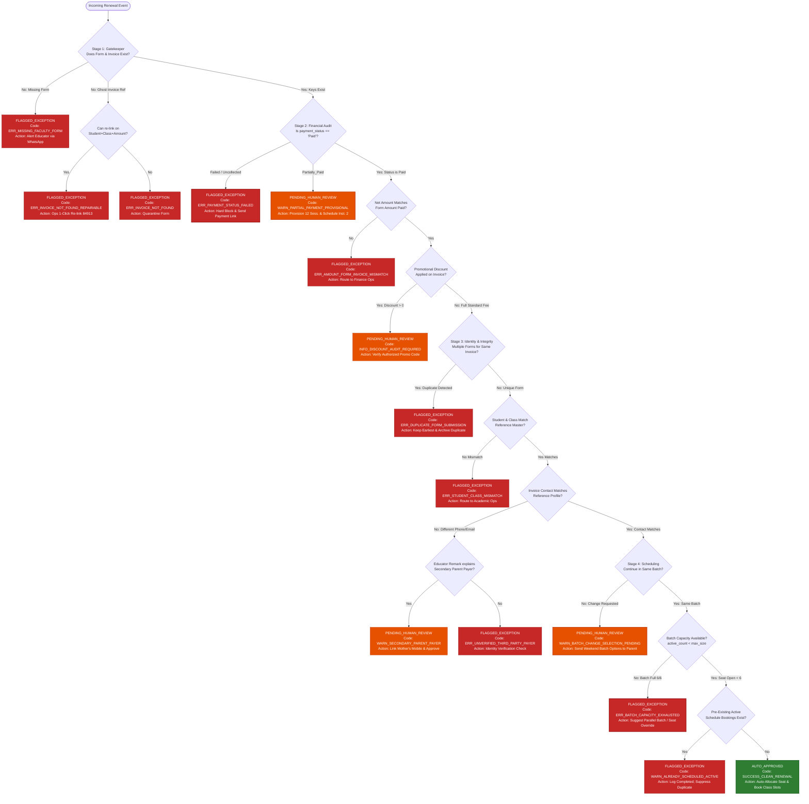

# RECONCILIATION & AUTO-APPROVAL BUSINESS RULES SPECIFICATION

**Company:** Bambinos.live  
**Role:** AI Program Manager (Operations)  
**Deliverable:** Reconciliation Engine Architecture & Business Logic Specification (`BUSINESS_RULES.md`)  
**Scope:** Automated Validation, Classification, and Routing of Student Renewal Operations across 5 core datasets:  
`1_invoices.csv`, `2_faculty_form_unapproved.csv`, `3_booking_requests.csv`, `4_class_schedule_bookings.csv`, `reference_active_batches_and_students.csv`  
**Guiding Principle:** **100% Deterministic Financial & Operational Validation.** An LLM is never permitted to approve payments or override business invariants.

---

## 1. Classification Framework

The reconciliation engine ingests raw operational records across payments, educator submissions, and LMS batch inventories, deterministically classifying each renewal record into exactly one of three terminal operational states:

```
                                  ┌───────────────────────────────┐
                                  │   INCOMING RENEWAL RECORD     │
                                  └───────────────┬───────────────┘
                                                  │
                 ┌────────────────────────────────┼────────────────────────────────┐
                 ▼                                ▼                                ▼
   ┌───────────────────────────┐    ┌───────────────────────────┐    ┌───────────────────────────┐
   │       AUTO_APPROVED       │    │     FLAGGED_EXCEPTION     │    │   PENDING_HUMAN_REVIEW    │
   ├───────────────────────────┤    ├───────────────────────────┤    ├───────────────────────────┤
   │ - Payment 100% Paid       │    │ - Payment Failed / Unpaid │    │ - Cross-parent contact    │
   │ - Full Net Amount Matches │    │ - Missing invoice/form    │    │   mismatch with remark    │
   │ - 1:1 Student/Class Match │    │ - Duplicate submission    │    │ - Installment 1 paid      │
   │ - Target Batch Has Space  │    │ - Batch 100% full (6/6)   │    │   (provisional 12 sess.)  │
   │ - Same-Batch Confirmed    │    │ - Critical amount error   │    │ - Batch change requested  │
   │ - Zero Conflicting Flags  │    │ - Corrupted foreign key   │    │ - Promotional discount    │
   └─────────────┬─────────────┘    └─────────────┬─────────────┘    └─────────────┬─────────────┘
                 ▼                                ▼                                ▼
      Instant Booking Request          Auto-Alert Slack/WhatsApp          Ops Action Dashboard
      & Schedule Class Slots           Block Pipeline / Notify Parent     One-Click Resolution
```

### Definitions:

1. **`AUTO_APPROVED`**:
   * **Criteria:** Meets all deterministic gates without exception. Gateway status is verified `Paid`, net amount equals educator-recorded amount and standard catalog fee (or authorized discount), student identity is unequivocally verified, `continue_same_batch == 'Yes'`, and batch capacity (`active_students_count < max_batch_size`).
   * **System Action:** Instantly sets `approval_status = 'Approved'`, generates a `booking_request` record with `batch_allocated = 'Yes'`, allocates the batch seat, and schedules all upcoming class slots in `class_schedule_bookings`.
   * **Target SLA:** `< 60 seconds` post-submission.

2. **`FLAGGED_EXCEPTION`**:
   * **Criteria:** Hard violation of core business, financial, or data integrity rules. Represents immediate risk of financial leakage, duplicate inventory reservation, or complete process omission (e.g., Payment Failed at gateway, missing invoice, non-existent foreign key, batch capacity exhausted, unfulfilled orphan payment).
   * **System Action:** Pipeline execution is halted immediately for this record. Auto-approval is strictly forbidden. Dispatches immediate automated alerts to Ops/Teacher via Slack/WhatsApp with a machine-readable failure reason code and recommended corrective action.
   * **Target SLA:** Real-time alert `< 5 minutes`; resolution within 4 hours.

3. **`PENDING_HUMAN_REVIEW`**:
   * **Criteria:** Genuine renewal intent and legitimate payment exist, but operational ambiguity or policy discretion is required. Examples: Payer contact details differ from LMS profile (mother paying for father-registered child), partial payment requiring installment provisioning, parent requesting a schedule/day change, or manual discount audit requirement.
   * **System Action:** Queued in the Operations Streamlit Dashboard under the "Assisted Review" tab. The system surfaces all pre-computed validation checks, highlights the exact discrepancy, and presents one-click resolution buttons (e.g., *"Accept Secondary Contact & Approve"*, *"Provision 12 Sessions"*, *"Suggest Saturday 11 AM Batch"*).
   * **Target SLA:** Operational review within 2 hours.

---

## 2. Core Validation Rules Catalog

Below is the definitive catalog of 12 business rules governing the reconciliation engine. Every rule details input fields, evaluation conditions, reason codes, recommended actions, and ownership.

---

### Rule 1: Invoice Existence & Foreign Key Integrity
* **Rule ID:** `BR-INV-001`
* **Rule Name:** Invoice Existence Verification
* **Input Columns:** `faculty_form.invoice_id`, `invoices.id`, `faculty_form.student_id`, `invoices.student_id`
* **Validation Condition:** The `invoice_id` entered on the faculty form must exist as a primary key in `invoices.id`.
* **Success Condition:** `faculty_form.invoice_id IN (invoices.id)` AND `faculty_form.student_id == invoices.student_id`.
* **Failure Condition:** 
  1. `faculty_form.invoice_id NOT IN (invoices.id)` (Orphan Form / Non-existent Invoice).
  2. `faculty_form.invoice_id IN (invoices.id)` BUT `faculty_form.student_id != invoices.student_id` (Invoice-Student ID Mismatch).
* **Reason Code:** 
  * `ERR_INVOICE_NOT_FOUND`
  * `ERR_INVOICE_STUDENT_MISMATCH`
* **Recommended Action:** 
  * Check if an unlinked paid invoice exists for the same `student_id` and `class_id` (heuristic repair candidate).
  * If found, present candidate repair to Ops (e.g., Form 3313 with ghost `84931` re-linked to Invoice `84913`).
  * If not found, quarantine form and alert submitting educator to provide a valid invoice link.
* **Responsible Person:** Operations Associate / Submitting Faculty Member
* **Classification State:** `FLAGGED_EXCEPTION`

---

### Rule 2: Payment Gateway Completion
* **Rule ID:** `BR-PAY-002`
* **Rule Name:** Deterministic Payment Completion Verification
* **Input Columns:** `invoices.payment_status`, `invoices.gateway_payment_id`, `invoices.paid_at`
* **Validation Condition:** Payment must be definitively captured and settled at the payment gateway (Razorpay/Stripe).
* **Success Condition:** `invoices.payment_status == 'Paid'` AND `invoices.gateway_payment_id IS NOT NULL` AND `invoices.paid_at IS NOT NULL`.
* **Failure Condition:**
  1. `invoices.payment_status == 'Failed'` (Payment failed, screenshot submitted by parent).
  2. `invoices.payment_status == 'Pending'` OR `invoices.gateway_payment_id IS NULL` OR `invoices.paid_at IS NULL`.
* **Reason Code:**
  * `ERR_PAYMENT_STATUS_FAILED`
  * `ERR_PAYMENT_UNCONFIRMED_GATEWAY`
* **Recommended Action:**
  * Strictly block auto-approval. Do not allow manual override without bank credit reference.
  * Trigger automated WhatsApp payment recovery message to parent containing Razorpay payment link.
  * Send Slack notification to educator: *"Payment for student {student_id} was rejected at gateway. Do not confirm classes."*
* **Responsible Person:** Billing & Collections Specialist
* **Classification State:** `FLAGGED_EXCEPTION`

---

### Rule 3: Payment Amount & Fee Verification
* **Rule ID:** `BR-PAY-003`
* **Rule Name:** Payment Amount Reconciliation
* **Input Columns:** `invoices.net_amount`, `faculty_form.amount_paid`, `reference.standard_fee_24_sessions_inr`, `invoices.discount_amount`, `invoices.payment_type`
* **Validation Condition:** The actual collected net amount in `invoices` must equal the amount recorded by the educator in `faculty_form`, and must equal the expected reference fee minus any documented discount.
* **Success Condition:** `ROUND(invoices.net_amount, 2) == ROUND(faculty_form.amount_paid, 2)` AND `ROUND(invoices.net_amount, 2) == ROUND(reference.standard_fee_24_sessions_inr - invoices.discount_amount, 2)` AND `invoices.payment_type == 'Full'`.
* **Failure Condition:**
  1. `invoices.net_amount != faculty_form.amount_paid` (Educator recorded amount differs from bank settlement).
  2. `invoices.net_amount < reference.standard_fee_24_sessions_inr - invoices.discount_amount` (Underpayment).
  3. `invoices.payment_type != 'Full'` (Installment payment; see Rule 4).
* **Reason Code:**
  * `ERR_AMOUNT_FORM_INVOICE_MISMATCH`
  * `ERR_UNDERPAYMENT_DETECTED`
  * `WARN_PARTIAL_PAYMENT_INSTALLMENT`
* **Recommended Action:**
  * If educator miskeyed amount on full payment, auto-correct form `amount_paid` to match gateway `net_amount` if student/class match reference.
  * If genuine underpayment exists, flag to Sales Ops for top-up payment link generation.
* **Responsible Person:** Operations Manager / Finance Controller
* **Classification State:** `FLAGGED_EXCEPTION` (if underpaid) or `PENDING_HUMAN_REVIEW` (if partial installment)

---

### Rule 4: Partial Payment & Installment Governance
* **Rule ID:** `BR-PAY-004`
* **Rule Name:** Installment & Partial Payment Handling
* **Input Columns:** `invoices.payment_status`, `invoices.payment_type`, `invoices.net_amount`, `invoices.amount`, `faculty_form.sessions_purchased`
* **Validation Condition:** Partial payments (`payment_status == 'Partially_Paid'` or `payment_type.startswith('Installment')`) must never be granted full 24-session approval automatically.
* **Success Condition (Automated Approval):** *None.* (By policy, partial payments cannot be auto-approved for full renewal).
* **Provisional Success Condition (Human Assisted):** `invoices.payment_status == 'Partially_Paid'` AND `invoices.net_amount >= (invoices.amount / 2)` AND `invoices.payment_type == 'Installment_1_of_2'`.
* **Failure Condition:** `invoices.payment_status == 'Partially_Paid'` but educator requests full 24 sessions in `faculty_form.sessions_purchased`.
* **Reason Code:** `WARN_PARTIAL_PAYMENT_PROVISIONAL_12_SESSIONS`
* **Recommended Action:**
  * Do not approve full 24-session renewal.
  * Surface record in Ops Review Queue: Permit Ops to issue **provisional approval for 12 sessions**.
  * Schedule automated SMS/WhatsApp trigger 7 days prior to Session 12 to collect Installment 2.
* **Responsible Person:** Operations Lead
* **Classification State:** `PENDING_HUMAN_REVIEW`

---

### Rule 5: Promotional Discount Verification
* **Rule ID:** `BR-PAY-005`
* **Rule Name:** Discount Authorization Audit
* **Input Columns:** `invoices.discount_amount`, `invoices.amount`, `invoices.net_amount`
* **Validation Condition:** Any invoice where `discount_amount > 0` must have an audit check confirming discount legitimacy.
* **Success Condition:** `invoices.discount_amount == 0.00` OR (`invoices.discount_amount > 0` AND `invoices.discount_amount <= (0.20 * invoices.amount)` AND `invoices.net_amount == invoices.amount - invoices.discount_amount`).
* **Failure Condition:** `invoices.discount_amount > (0.20 * invoices.amount)` (Discount > 20% without documented Director waiver) OR `invoices.net_amount != invoices.amount - invoices.discount_amount`.
* **Reason Code:**
  * `INFO_DISCOUNT_AUTHORIZED_STANDARD` (Discount <= 20%)
  * `WARN_DISCOUNT_THRESHOLD_EXCEEDED` (Discount > 20%)
* **Recommended Action:**
  * For standard authorized discounts (e.g. Invoice 84907 with 20% discount of INR 1,900), verify gateway settled `net_amount` (INR 7,600) and auto-approve or route to fast-track manager audit.
* **Responsible Person:** Sales Operations Team Lead
* **Classification State:** `PENDING_HUMAN_REVIEW` (Conservative governance) or `AUTO_APPROVED` (if pre-authorized promo code rule enabled)

---

### Rule 6: Student Identity & Course Enrollment Matching
* **Rule ID:** `BR-STD-006`
* **Rule Name:** Multi-Key Student & Course Alignment
* **Input Columns:** `faculty_form.student_id`, `invoices.student_id`, `reference.student_id`, `faculty_form.class_id`, `invoices.class_id`, `reference.class_id`, `faculty_form.educator_id`, `invoices.educator_id`
* **Validation Condition:** The student, purchased class, and assigned educator must be identical across `faculty_form`, `invoices`, and `reference`.
* **Success Condition:** `faculty_form.student_id == invoices.student_id == reference.student_id` AND `faculty_form.class_id == invoices.class_id == reference.class_id` AND `faculty_form.educator_id == invoices.educator_id == reference.educator_id`.
* **Failure Condition:**
  1. `student_id` does not exist in `reference_active_batches_and_students.csv`.
  2. `class_id` on invoice/form does not match student's enrolled `class_id` in reference table.
  3. `educator_id` mismatch across tables without documented batch transfer request.
* **Reason Code:**
  * `ERR_STUDENT_NOT_IN_MASTER`
  * `ERR_CLASS_MISMATCH`
  * `ERR_EDUCATOR_MISMATCH`
* **Recommended Action:**
  * Halt automation. Route to Academic Ops to verify if student is upgrading grade level/class curriculum.
* **Responsible Person:** Academic Operations Coordinator
* **Classification State:** `FLAGGED_EXCEPTION`

---

### Rule 7: Contact Divergence & Cross-Parent Payer Resolution
* **Rule ID:** `BR-CNT-007`
* **Rule Name:** Payer Contact Divergence Audit
* **Input Columns:** `invoices.mobile`, `invoices.email`, `invoices.parent_name`, `reference.registered_mobile_masked`, `reference.registered_email_masked`, `reference.parent_name_masked`, `faculty_form.remarks`
* **Validation Condition:** Contact details on invoice must match the LMS master profile, or must be substantiated by teacher remarks identifying a secondary parent/payer.
* **Success Condition:**
  * **Direct Match:** `invoices.mobile == reference.registered_mobile_masked` AND `invoices.email == reference.registered_email_masked`.
  * **Assisted Match:** `invoices.mobile != reference.registered_mobile_masked` BUT `faculty_form.remarks` contains explicit secondary payer keywords (e.g. *"mother paid"*, *"father paid"*, *"paid from different number"*) AND `student_id` and `class_id` match 100%.
* **Failure Condition:** Contact details diverge with zero teacher remark or contextual explanation.
* **Reason Code:**
  * `SUCCESS_CONTACT_VERIFIED` (Direct match)
  * `WARN_SECONDARY_PARENT_PAYER` (Assisted match with remarks)
  * `ERR_UNVERIFIED_THIRD_PARTY_PAYER` (Unexplained contact mismatch)
* **Recommended Action:**
  * For `WARN_SECONDARY_PARENT_PAYER` (e.g. Invoice 84904 where mother Ri***u paid while father Su***h is registered, noted in remarks): Route to Ops review to confirm secondary contact and auto-append mother's number to student profile.
  * For unexplained mismatches: Alert Ops to verify relationship before student renewal confirmation.
* **Responsible Person:** Operations Associate
* **Classification State:** `PENDING_HUMAN_REVIEW` (if assisted remark exists); `FLAGGED_EXCEPTION` (if unverified third-party)

---

### Rule 8: Idempotency & Duplicate Submission Detection
* **Rule ID:** `BR-DUP-008`
* **Rule Name:** Duplicate Renewal Request Detection
* **Input Columns:** `faculty_form.id`, `faculty_form.invoice_id`, `faculty_form.student_id`, `faculty_form.created_at`
* **Validation Condition:** Each invoice and renewal cycle must correspond to exactly one active faculty form.
* **Success Condition:** Exactly one pending/approved faculty form exists for the given `invoice_id`: `COUNT(faculty_form.id WHERE invoice_id == X) == 1`.
* **Failure Condition:** Multiple faculty form records exist for the same `invoice_id` (e.g., Forms 3308 and 3309 submitted 5 minutes apart for Invoice 84908).
* **Reason Code:** `ERR_DUPLICATE_FORM_SUBMISSION`
* **Recommended Action:**
  * **Automated Deduplication Protocol:**
    1. Select the record with the earliest timestamp (`MIN(created_at)`) as the `Primary_Active_Form` (Form 3308).
    2. Set subsequent identical submissions (`MAX(created_at)`) to `Archived_Duplicate` (Form 3309).
    3. Proceed with evaluation of the Primary Form.
* **Responsible Person:** System Automation (Deterministic Deduplicator) / Ops Associate
* **Classification State:** `FLAGGED_EXCEPTION` (Pending automated deduplication)

---

### Rule 9: Pre-Existing Booking & Double-Enrollment Guard
* **Rule ID:** `BR-BKG-009`
* **Rule Name:** Double Booking Prevention
* **Input Columns:** `invoices.id`, `booking_requests.invoice_id`, `class_schedule_bookings.invoice_id`, `booking_requests.request_status`
* **Validation Condition:** A new booking request or class schedule block must never be created if an active booking request or scheduled class block already exists for that invoice.
* **Success Condition:** `COUNT(booking_requests WHERE invoice_id == X) == 0` AND `COUNT(class_schedule_bookings WHERE invoice_id == X) == 0`.
* **Failure Condition:** Active booking request or class schedule already exists with status `Completed` or active class sessions (e.g., Invoice 84901 which already has Request 5501 and Slots 990101/990102).
* **Reason Code:** `WARN_ALREADY_SCHEDULED_ACTIVE`
* **Recommended Action:**
  * Block duplicate creation of booking requests or slot entries.
  * Log record as `ALREADY_COMPLETED`; prevent duplicate calendar invites.
* **Responsible Person:** Operations Systems Administrator
* **Classification State:** `FLAGGED_EXCEPTION` (Prevent duplicate booking)

---

### Rule 10: Same-Batch Renewal & Capacity Verification
* **Rule ID:** `BR-BAT-010`
* **Rule Name:** Same-Batch Capacity Check
* **Input Columns:** `faculty_form.continue_same_batch`, `faculty_form.current_classbatch_id`, `reference.active_students_count`, `reference.max_batch_size`
* **Validation Condition:** For students continuing in the same batch (`continue_same_batch == 'Yes'`), the batch occupancy must not exceed the hard limit of 6 students.
* **Success Condition:** `faculty_form.continue_same_batch == 'Yes'` AND `reference.active_students_count < reference.max_batch_size` (i.e. `slots_available >= 1`).
* **Failure Condition:** `faculty_form.continue_same_batch == 'Yes'` AND `reference.active_students_count >= reference.max_batch_size` (Batch Full, e.g. Batch 9205 with 6/6 occupancy).
* **Reason Code:**
  * `SUCCESS_SAME_BATCH_SEAT_AVAILABLE`
  * `ERR_BATCH_CAPACITY_EXHAUSTED`
* **Recommended Action:**
  * If seats available: Instantly allocate batch seat, update active count, and schedule class slots.
  * If batch full: Transition record to `FLAGGED_EXCEPTION`. Dispatch automated WhatsApp to parent displaying parallel batches with open capacity (e.g. Batch 9210), or prompt Academic Ops for an authorized batch size override from 6 to 7.
* **Responsible Person:** Batch Planning Lead / Academic Coordinator
* **Classification State:** 
  * `AUTO_APPROVED` (if `active_students_count < max_batch_size`)
  * `FLAGGED_EXCEPTION` (if `active_students_count >= max_batch_size`)

---

### Rule 11: Batch-Change Renewal & Schedule Re-Allocation
* **Rule ID:** `BR-BAT-011`
* **Rule Name:** Batch Change Preference Routing
* **Input Columns:** `faculty_form.continue_same_batch`, `faculty_form.preferred_days`, `faculty_form.preferred_time_slot`, `reference.class_id`
* **Validation Condition:** When a student requests a schedule/batch change (`continue_same_batch == 'No'`), the target batch must be verified for day/time slot match and available capacity before allocation.
* **Success Condition (Auto):** An open batch exists in LMS for the same `class_id` matching exact `preferred_days` and `preferred_time_slot` with `active_students_count < max_batch_size`.
* **Failure Condition:** No target batch specified (`classbatch_id == NULL`), or preferred day/time slot has no active batch, or matching batch is at full capacity (e.g., Booking Request 5512 for Student 68112).
* **Reason Code:**
  * `WARN_BATCH_CHANGE_AWAITING_SELECTION`
  * `ERR_BATCH_CHANGE_NO_SLOT_AVAILABLE`
* **Recommended Action:**
  * Do not auto-allocate.
  * Query LMS batch directory for candidate batches in the same grade level.
  * Send WhatsApp interactive message with 2–3 candidate batch options to parent for 1-click confirmation.
* **Responsible Person:** Customer Success Specialist / Batch Scheduling Coordinator
* **Classification State:** `PENDING_HUMAN_REVIEW`

---

### Rule 12: Missing Information & Process Completeness Guard
* **Rule ID:** `BR-DAT-012`
* **Rule Name:** Mandatory Field Completeness Audit
* **Input Columns:** All operational fields across `invoices`, `faculty_form`, `reference`
* **Validation Condition:** Mandatory fields required for financial audit and scheduling must never be NULL or empty strings.
* **Success Condition:** None of the following are NULL/empty:
  * Invoices: `id`, `user_id`, `student_id`, `class_id`, `educator_id`, `net_amount`, `payment_status`
  * Faculty Form: `id`, `invoice_id`, `student_id`, `class_id`, `educator_id`, `amount_paid`, `continue_same_batch`
* **Failure Condition:** Any mandatory attribute is NULL, blank, or string `"NULL"` (e.g., Invoice 84911 missing `gateway_payment_id` and `paid_at`; Booking Request 5512 missing `classbatch_id`).
* **Reason Code:** `ERR_MANDATORY_FIELD_MISSING`
* **Recommended Action:**
  * Halt automation. Flag missing data points in exception report. Never treat missing data as implicitly valid.
* **Responsible Person:** Data Operations Administrator
* **Classification State:** `FLAGGED_EXCEPTION`

---

## 3. Comprehensive Decision Table

The decision table below defines the exact evaluation matrix. Each row represents a specific state combination, its mapped business rules, terminal classification, and the real-world dataset records that fall into that category.

| Check 1: Invoice & Form Exists? | Check 2: Payment Status == 'Paid'? | Check 3: Net Amount Matches? | Check 4: Student & Class Match? | Check 5: Payer Contact Matches? | Check 6: Continue Same Batch? | Check 7: Batch Has Capacity (<6)? | Terminal Classification | Primary Reason Code | Real Dataset Record(s) |
|---|---|---|---|---|---|---|---|---|---|
| **Yes** | **Paid** | **Yes** | **Yes** | **Yes** | **Yes** | **Yes** | **`AUTO_APPROVED`** | `SUCCESS_CLEAN_RENEWAL` | **Invoice 84901** (Student 68101)<br>**Invoice 84903** (Student 68103)<br>**Invoice 84902** (Student 68102)* |
| **Yes** | **Paid** | **Yes** | **Yes** | **Yes** | **Yes** | **No (Full: 6/6)** | **`FLAGGED_EXCEPTION`** | `ERR_BATCH_CAPACITY_EXHAUSTED` | **Invoice 84905** (Student 68105, Batch 9205) |
| **No (Form Missing)** | **Paid** | N/A | **Yes** | **Yes** | N/A | N/A | **`FLAGGED_EXCEPTION`** | `ERR_MISSING_FACULTY_FORM` | **Invoice 84906** (Student 68106)<br>**Invoice 84910** (Student 68110) |
| **No (Invoice Typo)** | **Paid** | **Yes** | **Yes** | **Yes** | **Yes** | **Yes** | **`FLAGGED_EXCEPTION`** | `ERR_INVOICE_NOT_FOUND_REPAIRABLE` | **Invoice 84913** / Form 3313 (Ghost 84931) |
| **Yes** | **Failed** | N/A | **Yes** | **Yes** | **Yes** | **Yes** | **`FLAGGED_EXCEPTION`** | `ERR_PAYMENT_STATUS_FAILED` | **Invoice 84911** (Student 68111, Form 3311) |
| **Yes (Duplicate)** | **Paid** | **Yes** | **Yes** | **Yes** | **Yes** | **Yes** | **`FLAGGED_EXCEPTION`** | `ERR_DUPLICATE_FORM_SUBMISSION` | **Invoice 84908** (Student 68108, Forms 3308/3309) |
| **Yes** | **Partially_Paid** | **No (5.25k vs 10.5k)** | **Yes** | **Yes** | **Yes** | **Yes** | **`PENDING_HUMAN_REVIEW`** | `WARN_PARTIAL_PAYMENT_PROVISIONAL` | **Invoice 84909** (Student 68109, Form 3310) |
| **Yes** | **Paid** | **Yes (Discount 20%)** | **Yes** | **Yes** | **Yes** | **Yes** | **`PENDING_HUMAN_REVIEW`** | `INFO_DISCOUNT_AUDIT_REQUIRED` | **Invoice 84907** (Student 68107, Form 3307) |
| **Yes** | **Paid** | **Yes** | **Yes** | **No (Mother paid)** | **Yes** | **Yes** | **`PENDING_HUMAN_REVIEW`** | `WARN_SECONDARY_PARENT_PAYER` | **Invoice 84904** (Student 68104, Form 3304) |
| **Yes** | **Paid** | **Yes** | **Yes** | **Yes** | **No (Wants Sat/Sun)** | **N/A (Unselected)** | **`PENDING_HUMAN_REVIEW`** | `WARN_BATCH_CHANGE_SELECTION_PENDING` | **Invoice 84912** (Student 68112, Form 3312) |

*\*Note on Invoice 84902:* Form 3302 was approved manually in historical data, but sat stalled in `Pending_Batch_Allocation`. Under this specification, it qualifies for **`AUTO_APPROVED`** and immediate automated allocation because Batch 9202 has an open seat (5/6 occupancy).

---

## 4. End-to-End Reconciliation Logic Flowchart

The following Mermaid flowchart illustrates the sequential execution pipeline of the reconciliation engine, showing every gate, decision junction, and terminal state:



---

## 5. Predicted Engine Classification for All 13 Dataset Records

Applying the reconciliation business rules to the 13 records in the assessment datasets produces the following deterministic results:

| Invoice ID | Student ID | Payer Name | Amount | Payment Status | Faculty Form ID | Current Batch | Batch Capacity | Proposed Classification | Primary Reason Code | Automated / Human Action Required |
|---|---|---|---|---|---|---|---|---|---|---|
| **84901** | 68101 | Pr***a Sh***a | 12,000.00 | Paid | 3301 | 9201 | 4/6 (Open) | **`AUTO_APPROVED`** | `SUCCESS_CLEAN_RENEWAL` | Fully processed baseline. Already scheduled. |
| **84902** | 68102 | Ka***k Na***r | 10,500.00 | Paid | 3302 | 9202 | 5/6 (Open) | **`AUTO_APPROVED`** | `SUCCESS_CLEAN_RENEWAL` | Auto-allocate seat in Batch 9202; schedule class slots. |
| **84903** | 68103 | Ne***a Ve***a | 9,000.00 | Paid | 3303 | 9203 | 3/6 (Open) | **`AUTO_APPROVED`** | `SUCCESS_CLEAN_RENEWAL` | Instantly approve form 3303; create booking request & slots. |
| **84904** | 68104 | Ri***u Iy***r | 12,000.00 | Paid | 3304 | 9201 | 4/6 (Open) | **`PENDING_HUMAN_REVIEW`** | `WARN_SECONDARY_PARENT_PAYER` | 1-Click Ops confirmation: Mother paid; link number & approve. |
| **84905** | 68105 | Me***a Pa***l | 11,000.00 | Paid | 3305 | 9205 | 6/6 (FULL) | **`FLAGGED_EXCEPTION`** | `ERR_BATCH_CAPACITY_EXHAUSTED` | Alert Ops: Offer Chess Batch 9210 or request educator override to 7. |
| **84906** | 68106 | Fa***n Kh***n | 18,000.00 | Paid | None | 9206 | 5/6 (Open) | **`FLAGGED_EXCEPTION`** | `ERR_MISSING_FACULTY_FORM` | Automated WhatsApp chaser to Teacher Rhea B***; auto-generate form. |
| **84907** | 68107 | Po***a Jo***i | 7,600.00 | Paid | 3307 | 9207 | 4/6 (Open) | **`PENDING_HUMAN_REVIEW`** | `INFO_DISCOUNT_AUDIT_REQUIRED` | Sales Ops audit: Confirm 20% promotional discount and approve. |
| **84908** | 68108 | Ro***n Ma***a | 22,000.00 | Paid | 3308, 3309 | 9208 | 5/6 (Open) | **`FLAGGED_EXCEPTION`** | `ERR_DUPLICATE_FORM_SUBMISSION` | Auto-deduplicate: Retain Form 3308, archive 3309, then auto-approve. |
| **84909** | 68109 | Sn***a Ku***i | 5,250.00 | Partially_Paid | 3310 | 9209 | 4/6 (Open) | **`PENDING_HUMAN_REVIEW`** | `WARN_PARTIAL_PAYMENT_PROVISIONAL` | Approve provisional 12 sessions; schedule reminder for Inst. 2. |
| **84910** | 68110 | Vi***m Re***y | 11,000.00 | Paid | None | 9210 | 5/6 (Open) | **`FLAGGED_EXCEPTION`** | `ERR_MISSING_FACULTY_FORM` | Automated WhatsApp chaser to Coach Arvind K***; auto-generate form. |
| **84911** | 68111 | An***i Gu***a | 12,000.00 | Failed | 3311 | 9211 | 5/6 (Open) | **`FLAGGED_EXCEPTION`** | `ERR_PAYMENT_STATUS_FAILED` | Hard reject form 3311. Send payment retry link to parent. |
| **84912** | 68112 | De***k Me***n | 9,000.00 | Paid | 3312 | 9203 | 3/6 (Open) | **`PENDING_HUMAN_REVIEW`** | `WARN_BATCH_CHANGE_SELECTION_PENDING` | Send WhatsApp showing open Sat/Sun 11 AM batches in Class 301. |
| **84913** | 68113 | Ar***n Me***a | 11,500.00 | Paid | 3313 (Ghost) | 9213 | 4/6 (Open) | **`FLAGGED_EXCEPTION`** | `ERR_INVOICE_NOT_FOUND_REPAIRABLE` | Assisted 1-click re-link: Replace typo 84931 with 84913 and approve. |

---

## 6. Business Clarifications Required (Open Policy Questions)

The following 8 operational edge cases cannot be resolved purely from schema inspection and require definitive policy sign-off from Bambinos.live leadership:

### 1. Partial Payment Entitlement Policy
* **Current Data:** Invoice 84909 has `payment_type = 'Installment_1_of_2'`, `net_amount = 5,250.00` (50% of the 24-session fee of INR 10,500).
* **Open Question:** Does payment of Installment 1 entitle the student to an immediate provisional batch allocation of **12 sessions**, or must the student be withheld from class scheduling until Installment 2 (the remaining INR 5,250) is collected?
* **Engine Impact:** If provisional booking is permitted, the engine auto-creates a booking request with `sessions_count = 12`. If not, the engine marks the record as `AWAITING_INSTALLMENT_2` and blocks allocation.

### 2. Batch Capacity Ceiling & Overbooking Threshold
* **Current Data:** Batch 9205 (`CM-G4-Batch-D`) has `active_students_count = 6` and `max_batch_size = 6`. Student 68105 paid in full to renew in this batch.
* **Open Question:** Is the maximum batch size of 6 a strict physical ceiling, or does the academic coordinator have authority to grant a **+1 soft overbooking override** (expanding the batch to 7 students) if the educator agrees?
* **Engine Impact:** Determines whether the engine routes batch-full events to a parent re-allocation workflow (offering alternate batches) or to an educator capacity waiver request.

### 3. Promotional Discount Approval Hierarchy
* **Current Data:** Invoice 84907 applied a 20% discount (INR 1,900 off INR 9,500, Net = INR 7,600). The dataset contains no discount code, voucher ID, or approving manager's user ID.
* **Open Question:** What is the governance threshold for discounts? Are discounts up to 20% considered pre-authorized at checkout, or must every discounted renewal receive written approval from the Sales Head before class booking?
* **Engine Impact:** Determines whether Invoice 84907 is routed to `AUTO_APPROVED` or held in `PENDING_HUMAN_REVIEW`.

### 4. Cross-Parent Secondary Contact Validation Protocol
* **Current Data:** Invoice 84904 was paid by the student's mother (`Ri***u Iy***r`, `+91-9844XXXX77`), whereas the LMS master profile is registered under the father (`Su***h Iy***r`, `+91-9844XXXX04`). Teacher Rhea noted: *"Mother paid from her number"*.
* **Open Question:** Is a teacher remark in `faculty_form.remarks` legally and operationally sufficient to validate a payer contact mismatch, or must Ops call the father's registered number to confirm authorization?
* **Engine Impact:** If the teacher remark is sufficient, the engine can auto-alias the secondary phone and auto-approve. If phone verification is required, it must remain in manual review.

### 5. Automated Teacher Form Generation (Bypassing Teacher Submission)
* **Current Data:** Invoices 84906 (INR 18,000) and 84910 (INR 11,000) were paid on Nov 2nd and Nov 3rd, but the assigned teachers never submitted faculty forms.
* **Open Question:** If a teacher fails to submit a renewal form within an agreed SLA (e.g. 2 hours post-payment), is the system authorized to **auto-generate a renewal faculty form** using the student's active reference batch data (`continue_same_batch = 'Yes'`)?
* **Engine Impact:** Enables a self-healing pipeline that eliminates the 18.18% orphaned invoice rate without human intervention.

### 6. Stripe Currency Settlement Configuration
* **Current Data:** Invoices 84906 and 84908 have international payment gateways (`payment_gateway = 'Stripe'`), international mobile prefixes (`+971`, `+1`), but `currency = 'INR'`.
* **Open Question:** Is charging international parents in INR via Stripe standard operating procedure (settled via Stripe multi-currency conversion), or is this an artifact of checkout misconfiguration that requires currency conversion audit?
* **Engine Impact:** If standard, the engine treats Stripe INR payments identically to Razorpay INR payments. If not, currency verification rules must be introduced.

### 7. Batch Change SLA & Parent Auto-Allocation
* **Current Data:** Student 68112 (Invoice 84912) requested a shift to weekend 11:00 AM classes. The request is currently stalled awaiting parent selection.
* **Open Question:** If a parent requests a batch change and is sent 3 candidate batch slots via WhatsApp, what is the expiry SLA (e.g., 48 hours)? If the parent does not respond within the SLA, should the student remain in their existing weekday batch or be placed on temporary hold?
* **Engine Impact:** Dictates automated escalation rules and fallback batch assignment in n8n/engine.

### 8. End-of-Cycle Deduplication & Form Versioning
* **Current Data:** Forms 3308 and 3309 were submitted for Invoice 84908 within 5 minutes of each other with identical data.
* **Open Question:** In future scenarios where an educator submits a second form with *different* remarks or batch preferences (e.g. parent changed mind), does the latest submission supersede the earlier one (`Latest Wins`), or must both forms be quarantined for Ops review?
* **Engine Impact:** Defines whether automated deduplication always takes `MIN(created_at)`, `MAX(created_at)`, or flags a diff alert when fields diverge.

---

*Specification certified on 2026-11-05. Ready for review and subsequent implementation in Deliverable B.*

