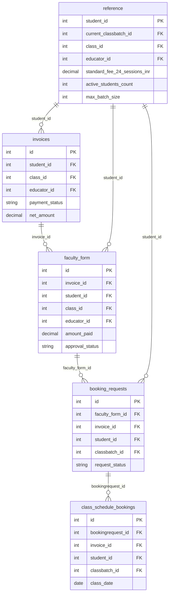

# DATASET ANALYSIS — Bambinos.live AI Program Manager

> **Date**: 2026-11-05 | **Analyst**: AI Automation Engine  
> **Source files**: 5 CSV datasets from the Bambinos.live assessment repository  
> **Methodology**: All findings are derived programmatically from the raw CSV data. No values invented or assumed.

---

## Table of Contents

1. [Dataset Overview](#1-dataset-overview)
2. [Schema: Each Table](#2-schema-each-table)
3. [Sample Records (5–10 per table)](#3-sample-records)
4. [Relationships Between Tables](#4-relationships-between-tables)
5. [Data Quality Issues](#5-data-quality-issues)
6. [Column Classification](#6-column-classification)
7. [Potential Matching Keys](#7-potential-matching-keys)
8. [Business Clarifications Required](#8-business-clarifications-required)

---

## 1. Dataset Overview

| # | File | Table Name | Rows | Columns | Purpose |
|---|---|---|---|---|---|
| 1 | `1_invoices.csv` | `invoices` | **13** | **25** | Source-of-truth for all payments |
| 2 | `2_faculty_form_unapproved.csv` | `faculty_form` | **12** | **23** | Educator-submitted renewal forms awaiting ops approval |
| 3 | `3_booking_requests.csv` | `booking_requests` | **4** | **20** | Batch allocation requests (created after form approval) |
| 4 | `4_class_schedule_bookings.csv` | `class_schedule_bookings` | **2** | **18** | Actual class slots scheduled for a student |
| 5 | `reference_active_batches_and_students.csv` | `reference` | **13** | **20** | Master reference: active students + batch configurations |

**Total records across all tables: 44**

### Pipeline Funnel (Records flowing through the process)

```
13 Invoices
  → 12 Faculty Forms (1 invoice has no form; 1 form has ghost invoice)
      → 4 Booking Requests (8 approved/pending forms have no booking request)
          → 2 Class Schedule Bookings (only 1 student fully scheduled)
```

> NOTE: Only **1 out of 13** renewal invoices has fully completed the end-to-end process (Invoice → Form → Booking Request → Class Slots). The pipeline has significant blockages.

---

## 2. Schema: Each Table

### 2.1 `invoices` — 13 rows × 25 columns

| Column | Inferred Type | Nullable | Unique Values | Missing (NULL/NaN) | Notes |
|---|---|---|---|---|---|
| `id` | INTEGER | No | 13 | 0 | **Primary Key** |
| `invoice_number` | STRING | No | 13 | 0 | Human-readable ID (`BMB-INV-2026-XXXXX`) |
| `user_id` | INTEGER | No | 13 | 0 | Parent account ID |
| `student_id` | INTEGER | No | 13 | 0 | FK → reference |
| `class_id` | INTEGER | No | 11 | 0 | Class type purchased |
| `educator_id` | INTEGER | No | 6 | 0 | Assigned educator |
| `parent_name` | STRING (masked) | No | 13 | 0 | PII masked |
| `mobile` | STRING (masked) | No | 13 | 0 | Payment-time mobile; may differ from registered |
| `email` | STRING (masked) | No | 13 | 0 | PII masked |
| `currency` | STRING | No | 1 | 0 | All `INR` — even Stripe transactions |
| `amount` | DECIMAL | No | 8 | 0 | Gross listed price |
| `discount_amount` | DECIMAL | No | 2 | 0 | Discount applied; mostly `0.00` |
| `net_amount` | DECIMAL | No | 9 | 0 | Actual amount charged = amount − discount |
| `payment_type` | STRING | No | 2 | 0 | `Full` (12) or `Installment_1_of_2` (1) |
| `payment_mode` | STRING | No | 3 | 0 | `UPI`, `Card`, `Netbanking` |
| `payment_gateway` | STRING | No | 2 | 0 | `Razorpay` (11), `Stripe` (2) |
| `gateway_order_id` | STRING | No | 13 | 0 | Gateway-generated order ref |
| `gateway_payment_id` | STRING | **Yes** | 13 | **1** | NULL for invoice 84911 (Failed) |
| `invoice_link` | STRING (URL) | No | 13 | 0 | Shareable invoice URL |
| `payment_status` | STRING | No | 3 | 0 | `Paid` (11), `Partially_Paid` (1), `Failed` (1) |
| `is_renewal` | STRING | No | 1 | 0 | All `Yes` — entire dataset is renewals |
| `paid_at` | DATETIME | **Yes** | 13 | **1** | NULL for invoice 84911 (Failed) |
| `created_at` | DATETIME | No | 13 | 0 | Format: `YYYY-MM-DD HH:MM:SS` |
| `updated_at` | DATETIME | No | 13 | 0 | Format: `YYYY-MM-DD HH:MM:SS` |
| `deleted_at` | DATETIME | Yes | 1 | 13 | All NULL — no soft-deleted records |

**Distinct values for key categorical columns:**

| Column | Values |
|---|---|
| `payment_status` | `Paid` (11), `Partially_Paid` (1), `Failed` (1) |
| `payment_type` | `Full` (12), `Installment_1_of_2` (1) |
| `payment_gateway` | `Razorpay` (11), `Stripe` (2) |
| `payment_mode` | `UPI` (7), `Card` (4), `Netbanking` (1) |
| `currency` | `INR` (13) — all records |
| `is_renewal` | `Yes` (13) — all records |

---

### 2.2 `faculty_form` — 12 rows × 23 columns

| Column | Inferred Type | Nullable | Unique Values | Missing (NULL/NaN) | Notes |
|---|---|---|---|---|---|
| `id` | INTEGER | No | 12 | 0 | **Primary Key** |
| `educator_id` | INTEGER | No | 6 | 0 | FK → reference |
| `educator_name` | STRING (masked) | No | 6 | 0 | PII masked |
| `user_id` | INTEGER | No | 11 | 0 | Parent account; 2 forms share same user |
| `student_id` | INTEGER | No | 11 | 0 | FK → reference |
| `student_name` | STRING (masked) | No | 11 | 0 | PII masked |
| `parent_mobile` | STRING (masked) | No | 11 | 0 | Mobile at time of form submission |
| `class_id` | INTEGER | No | 9 | 0 | FK → reference |
| `current_classbatch_id` | INTEGER | No | 9 | 0 | Batch student is currently enrolled in |
| `invoice_id` | INTEGER | No | 11 | 0 | FK → invoices (one ID: 84931 not in invoices) |
| `invoice_link` | STRING (URL) | No | 11 | 0 | URL in form matches invoice table URL |
| `amount_paid` | DECIMAL | No | 7 | 0 | Educator-recorded payment amount |
| `sessions_purchased` | INTEGER | No | 1 | 0 | All `24` |
| `continue_same_batch` | STRING | No | 2 | 0 | `Yes` (11), `No` (1) |
| `preferred_days` | STRING (comma-separated) | No | 6 | 0 | e.g. `Tue,Thu` |
| `preferred_time_slot` | TIME | No | 8 | 0 | Format: `HH:MM:SS` |
| `remarks` | STRING | No | 12 | 0 | Free text from educator |
| `approval_status` | STRING | No | 2 | 0 | `Pending` (8), `Approved` (4) |
| `approved_by` | STRING | **Yes** | 4 | **8** | NULL for all Pending forms |
| `approved_at` | DATETIME | **Yes** | 5 | **8** | NULL for all Pending forms |
| `created_at` | DATETIME | No | 12 | 0 | Format: `YYYY-MM-DD HH:MM:SS` |
| `updated_at` | DATETIME | No | 12 | 0 | Format: `YYYY-MM-DD HH:MM:SS` |
| `deleted_at` | DATETIME | Yes | 1 | 12 | All NULL |

**Distinct values for key categorical columns:**

| Column | Values |
|---|---|
| `approval_status` | `Pending` (8), `Approved` (4) |
| `continue_same_batch` | `Yes` (11), `No` (1) |
| `sessions_purchased` | `24` (12) — all identical |
| `approved_by` | `ops_exec_01`, `ops_exec_02` (only on Approved rows) |

> NOTE: `user_id` and `student_id` have only 11 unique values across 12 rows. Form 3308 is a **duplicate submission** for invoice 84908 — two faculty form rows share the same invoice_id 84908 and student_id 68108.

---

### 2.3 `booking_requests` — 4 rows × 20 columns

| Column | Inferred Type | Nullable | Unique Values | Missing (NULL/NaN) | Notes |
|---|---|---|---|---|---|
| `id` | INTEGER | No | 4 | 0 | **Primary Key** |
| `faculty_form_id` | INTEGER | No | 4 | 0 | FK → faculty_form |
| `invoice_id` | INTEGER | No | 4 | 0 | FK → invoices |
| `user_id` | INTEGER | No | 4 | 0 | Parent account |
| `student_id` | INTEGER | No | 4 | 0 | FK → reference |
| `class_id` | INTEGER | No | 4 | 0 | FK → reference |
| `educator_id` | INTEGER | No | 4 | 0 | FK → reference |
| `classbatch_id` | INTEGER | **Yes** | 4 | **1** | NULL when batch not yet allocated |
| `sessions_count` | INTEGER | No | 1 | 0 | All `24` |
| `is_renewal` | STRING | No | 1 | 0 | All `Yes` |
| `continue_same_batch` | STRING | No | 2 | 0 | `Yes` (3), `No` (1) |
| `preferred_days` | STRING | No | 3 | 0 | Comma-separated day codes |
| `preferred_time` | TIME | No | 3 | 0 | Format: `HH:MM:SS` |
| `request_status` | STRING | No | 4 | 0 | One per status (see below) |
| `batch_allocated` | STRING | No | 2 | 0 | `Yes` (1), `No` (3) |
| `allocated_by` | STRING | **Yes** | 2 | **3** | NULL when not allocated |
| `allocated_at` | DATETIME | **Yes** | 2 | **3** | NULL when not allocated |
| `created_at` | DATETIME | No | 4 | 0 | Format: `YYYY-MM-DD HH:MM:SS` |
| `updated_at` | DATETIME | No | 4 | 0 | Format: `YYYY-MM-DD HH:MM:SS` |
| `deleted_at` | DATETIME | Yes | 1 | 4 | All NULL |

**All 4 request statuses (one each):**

| `request_status` | `batch_allocated` | Meaning |
|---|---|---|
| `Completed` | Yes | Fully processed — classes scheduled |
| `Pending_Batch_Allocation` | No | Waiting for ops to assign a batch |
| `Failed_Batch_Full` | No | Requested batch is at full capacity |
| `Awaiting_Parent_Batch_Selection` | No | Parent needs to choose an alternative batch |

---

### 2.4 `class_schedule_bookings` — 2 rows × 18 columns

| Column | Inferred Type | Nullable | Unique Values | Missing (NULL/NaN) | Notes |
|---|---|---|---|---|---|
| `id` | INTEGER | No | 2 | 0 | **Primary Key** |
| `bookingrequest_id` | INTEGER | No | 1 | 0 | FK → booking_requests (both rows = 5501) |
| `invoice_id` | INTEGER | No | 1 | 0 | FK → invoices (both rows = 84901) |
| `classschedule_id` | INTEGER | No | 2 | 0 | Unique class-slot ID |
| `classbatch_id` | INTEGER | No | 1 | 0 | Both in batch 9201 |
| `class_id` | INTEGER | No | 1 | 0 | Both class 104 |
| `user_id` | INTEGER | No | 1 | 0 | Both user 41021 |
| `student_id` | INTEGER | No | 1 | 0 | Both student 68101 |
| `educator_id` | INTEGER | No | 1 | 0 | Both educator 1102 |
| `class_date` | DATE | No | 2 | 0 | Format: `YYYY-MM-DD` (date-only, unlike other tables) |
| `start_time` | TIME | No | 1 | 0 | Both `17:00:00` |
| `end_time` | TIME | No | 1 | 0 | Both `17:50:00` — 50-minute sessions |
| `booking_type` | STRING | No | 1 | 0 | Both `Regular_Renewal` |
| `is_cancelled` | STRING | No | 1 | 0 | Both `No` |
| `attended_class` | STRING | No | 2 | 0 | `Yes` (past slot), `No` (future slot) |
| `created_at` | DATETIME | No | 1 | 0 | Both same timestamp (created together) |
| `updated_at` | DATETIME | No | 2 | 0 | Past slot updated after class; future slot unchanged |
| `deleted_at` | DATETIME | Yes | 1 | 2 | All NULL |

> NOTE: Only **2 class slots** exist — both for a single student (68101, invoice 84901). This table is essentially empty relative to the 11 paid invoices awaiting processing.

---

### 2.5 `reference` (Active Batches & Students) — 13 rows × 20 columns

| Column | Inferred Type | Nullable | Unique Values | Notes |
|---|---|---|---|---|
| `student_id` | INTEGER | No | 13 | **Primary Key** |
| `user_id` | INTEGER | No | 13 | Parent account |
| `student_name_masked` | STRING | No | 13 | PII masked |
| `parent_name_masked` | STRING | No | 13 | PII masked |
| `registered_mobile_masked` | STRING | No | 13 | **Authoritative mobile** for validation |
| `registered_email_masked` | STRING | No | 13 | PII masked |
| `current_classbatch_id` | INTEGER | No | 11 | Current enrolled batch (11 unique batches) |
| `classbatch_name` | STRING | No | 11 | Human-readable batch code |
| `class_id` | INTEGER | No | 11 | FK → class |
| `class_name` | STRING | No | 11 | Human-readable class name |
| `category_id` | INTEGER | No | 5 | 1=English, 2=Maths, 3=Gita, 4=Chess, 5=Science |
| `category_name` | STRING | No | 5 | Category label |
| `educator_id` | INTEGER | No | 6 | Assigned educator |
| `educator_name` | STRING (masked) | No | 6 | PII masked |
| `standard_fee_24_sessions_inr` | DECIMAL | No | 8 | **Canonical expected fee** for validation |
| `batch_days` | STRING | No | 7 | Scheduled days (comma-separated) |
| `batch_start_time` | TIME | No | 9 | Format: `HH:MM:SS` |
| `active_students_count` | INTEGER | No | 4 | Current occupancy |
| `max_batch_size` | INTEGER | No | 1 | All batches max = **6** |
| `deleted_at` | DATETIME | Yes | 1 | All NULL — no inactive students |

**Batch capacity status:**

| Batch ID | Name | Class | Students | Max | Full? |
|---|---|---|---|---|---|
| 9201 | YC-G4-Batch-A | 104 | 4 | 6 | No |
| 9202 | BM-G5-Batch-C | 205 | 5 | 6 | No |
| 9203 | LY-G3-Batch-B | 301 | 3 | 6 | No |
| **9205** | **CM-G4-Batch-D** | **402** | **6** | **6** | **YES — FULL** |
| 9206 | YC-GCC-Batch-E | 108 | 5 | 6 | No |
| 9207 | PH-G1-Batch-F | 101 | 4 | 6 | No |
| 9208 | LY-US-Batch-G | 302 | 5 | 6 | No |
| 9209 | BM-G3-Batch-H | 204 | 4 | 6 | No |
| 9210 | CM-G2-Batch-I | 401 | 5 | 6 | No |
| 9211 | YC-G2-Batch-J | 102 | 5 | 6 | No |
| 9213 | SC-G4-Batch-K | 501 | 4 | 6 | No |

---

## 3. Sample Records

### 3.1 Invoices (all 13 shown)

| id | invoice_number | student_id | class_id | payment_status | net_amount | discount | gateway | paid_at |
|---|---|---|---|---|---|---|---|---|
| 84901 | BMB-INV-2026-84901 | 68101 | 104 | Paid | 12000.00 | 0 | Razorpay | 2026-11-01 10:15:22 |
| 84902 | BMB-INV-2026-84902 | 68102 | 205 | Paid | 10500.00 | 0 | Razorpay | 2026-11-01 14:20:10 |
| 84903 | BMB-INV-2026-84903 | 68103 | 301 | Paid | 9000.00 | 0 | Razorpay | 2026-11-02 09:05:44 |
| 84904 | BMB-INV-2026-84904 | 68104 | 104 | Paid | 12000.00 | 0 | Razorpay | 2026-11-02 11:30:05 |
| 84905 | BMB-INV-2026-84905 | 68105 | 402 | Paid | 11000.00 | 0 | Razorpay | 2026-11-02 13:10:19 |
| 84906 | BMB-INV-2026-84906 | 68106 | 108 | Paid | 18000.00 | 0 | **Stripe** | 2026-11-02 16:00:00 |
| 84907 | BMB-INV-2026-84907 | 68107 | 101 | Paid | **7600.00** | **1900** | Razorpay | 2026-11-02 18:45:30 |
| 84908 | BMB-INV-2026-84908 | 68108 | 302 | Paid | 22000.00 | 0 | **Stripe** | 2026-11-03 08:15:11 |
| 84909 | BMB-INV-2026-84909 | 68109 | 204 | **Partially_Paid** | **5250.00** | 0 | Razorpay | 2026-11-03 10:00:00 |
| 84910 | BMB-INV-2026-84910 | 68110 | 401 | Paid | 11000.00 | 0 | Razorpay | 2026-11-03 11:20:45 |
| 84911 | BMB-INV-2026-84911 | 68111 | 102 | **Failed** | 12000.00 | 0 | Razorpay | **NULL** |
| 84912 | BMB-INV-2026-84912 | 68112 | 301 | Paid | 9000.00 | 0 | Razorpay | 2026-11-03 15:40:12 |
| 84913 | BMB-INV-2026-84913 | 68113 | 501 | Paid | 11500.00 | 0 | Razorpay | 2026-11-03 16:50:00 |

### 3.2 Faculty Forms (all 12 shown)

| id | invoice_id | student_id | educator_id | amount_paid | continue_same_batch | approval_status | Issue |
|---|---|---|---|---|---|---|---|
| 3301 | 84901 | 68101 | 1102 | 12000.00 | Yes | Approved | — |
| 3302 | 84902 | 68102 | 1108 | 10500.00 | Yes | Approved | — |
| 3303 | 84903 | 68103 | 1115 | 9000.00 | Yes | Pending | Awaiting auto-approval |
| 3304 | 84904 | 68104 | 1102 | 12000.00 | Yes | Pending | Mobile mismatch on invoice |
| 3305 | 84905 | 68105 | 1122 | 11000.00 | Yes | Approved | Batch 9205 is full |
| 3306 | 84906 | 68106 | 1102 | 18000.00 | Yes | Pending | Stripe gateway (international) |
| 3307 | 84907 | 68107 | 1125 | 7600.00 | Yes | Pending | Discount applied |
| 3308 | 84908 | 68108 | 1115 | 22000.00 | Yes | Pending | Duplicate form for same invoice |
| 3309 | 84909 | 68109 | 1108 | **10500.00** | Yes | Pending | amount_paid ≠ invoice net_amount (5250) |
| 3310 | 84910 | 68110 | 1122 | 11000.00 | Yes | Pending | Awaiting auto-approval |
| 3311 | 84911 | 68111 | 1125 | 12000.00 | Yes | Pending | Payment FAILED — must NOT approve |
| 3312 | 84912 | 68112 | 1115 | 9000.00 | **No** | Approved | Batch change requested |
| 3313 | **84931** | 68113 | 1130 | 11500.00 | Yes | Pending | Invoice 84931 does not exist |

### 3.3 Booking Requests (all 4 shown)

| id | faculty_form_id | invoice_id | student_id | classbatch_id | request_status | batch_allocated |
|---|---|---|---|---|---|---|
| 5501 | 3301 | 84901 | 68101 | 9201 | Completed | Yes |
| 5502 | 3302 | 84902 | 68102 | 9202 | Pending_Batch_Allocation | No |
| 5505 | 3305 | 84905 | 68105 | 9205 | Failed_Batch_Full | No |
| 5512 | 3312 | 84912 | 68112 | NULL | Awaiting_Parent_Batch_Selection | No |

### 3.4 Class Schedule Bookings (all 2 shown)

| id | bookingrequest_id | invoice_id | student_id | class_date | start_time | attended_class |
|---|---|---|---|---|---|---|
| 990101 | 5501 | 84901 | 68101 | 2026-11-03 | 17:00:00 | Yes |
| 990102 | 5501 | 84901 | 68101 | 2026-11-05 | 17:00:00 | No (future) |

### 3.5 Reference — Active Batches & Students (all 13)

| student_id | user_id | classbatch_id | class_name | educator_id | std_fee | batch_days | capacity |
|---|---|---|---|---|---|---|---|
| 68101 | 41021 | 9201 | Young Communicators L2 | 1102 | 12000 | Tue,Thu | 4/6 |
| 68102 | 41022 | 9202 | Unbox Maths L3 | 1108 | 10500 | Mon,Wed | 5/6 |
| 68103 | 41023 | 9203 | Little Yogi Gita L1 | 1115 | 9000 | Wed,Fri | 3/6 |
| 68104 | 41024 | 9201 | Young Communicators L2 | 1102 | 12000 | Tue,Thu | 4/6 |
| 68105 | 41025 | 9205 | Unbox Chess L2 | 1122 | 11000 | Sat,Sun | **6/6 FULL** |
| 68106 | 41026 | 9206 | Young Communicators GCC | 1102 | 18000 | Sun,Tue | 5/6 |
| 68107 | 41027 | 9207 | Phonics Champions L1 | 1125 | 9500 | Mon,Thu | 4/6 |
| 68108 | 41028 | 9208 | Little Yogi Gita US | 1115 | 22000 | Sat,Sun | 5/6 |
| 68109 | 41029 | 9209 | Unbox Maths L2 | 1108 | 10500 | Tue,Fri | 4/6 |
| 68110 | 41030 | 9210 | Unbox Chess L1 | 1122 | 11000 | Wed,Fri | 5/6 |
| 68111 | 41031 | 9211 | Young Communicators L1 | 1125 | 12000 | Mon,Wed | 5/6 |
| 68112 | 41032 | 9203 | Little Yogi Gita L1 | 1115 | 9000 | Wed,Fri | 3/6 |
| 68113 | 41033 | 9213 | Unbox Science L1 | 1130 | 11500 | Tue,Thu | 4/6 |

---

## 4. Relationships Between Tables

### 4.1 Entity-Relationship Map



### 4.2 Join Keys Summary

| Join | Left Table | Right Table | Key | Coverage |
|---|---|---|---|---|
| A | `invoices` | `faculty_form` | `invoices.id = faculty_form.invoice_id` | 11/13 invoices matched; 1 form orphan (84931) |
| B | `faculty_form` | `booking_requests` | `faculty_form.id = booking_requests.faculty_form_id` | 4/12 forms have a booking request |
| C | `booking_requests` | `class_schedule_bookings` | `booking_requests.id = class_schedule_bookings.bookingrequest_id` | 1/4 requests has class slots |
| D | `invoices` | `reference` | `invoices.student_id = reference.student_id` | 13/13 — perfect match |
| E | `faculty_form` | `reference` | `faculty_form.student_id = reference.student_id` | 11/12 — form 3313 student 68113 is in reference |

### 4.3 Cross-table Invoice Coverage

| Invoice | Faculty Form | Booking Request | Class Bookings | Status |
|---|---|---|---|---|
| 84901 | 3301 | 5501 | 2 slots | **Fully processed** |
| 84902 | 3302 | 5502 (pending alloc) | — | Stalled at batch allocation |
| 84903 | 3303 | — | — | Form pending approval |
| 84904 | 3304 | — | — | Form pending (mobile mismatch) |
| 84905 | 3305 | 5505 (batch full) | — | Blocked — batch full |
| 84906 | — | — | — | No faculty form at all |
| 84907 | 3307 | — | — | Form pending (discount) |
| 84908 | 3308 (×2 dup) | — | — | Duplicate form; both pending |
| 84909 | 3309 | — | — | Form pending (partial payment) |
| 84910 | — | — | — | No faculty form at all |
| 84911 | 3311 | — | — | Form pending — payment FAILED |
| 84912 | 3312 | 5512 (awaiting parent) | — | Stalled — batch change needed |
| 84913 | 3313 (wrong inv.) | — | — | Orphan form (references invoice 84931) |

---

## 5. Data Quality Issues

### 5.1 Critical Issues (block processing)

| # | Code | Table | Record(s) | Description | Impact |
|---|---|---|---|---|---|
| **C1** | `PAYMENT_FAILED` | invoices | 84911 | `payment_status=Failed`, `gateway_payment_id=NULL`, `paid_at=NULL` | Faculty form 3311 must NOT be approved |
| **C2** | `ORPHAN_FORM` | faculty_form | 3313 | References invoice `84931` which does not exist in invoices table | Cannot validate payment; form cannot proceed |
| **C3** | `AMOUNT_MISMATCH` | faculty_form | 3309 | `amount_paid=10500` but invoice net_amount=5250 (installment 1 of 2) | Educator recorded full fee; only half received |

### 5.2 High-Priority Issues (require ops decision)

| # | Code | Table | Record(s) | Description | Impact |
|---|---|---|---|---|---|
| **H1** | `MOBILE_MISMATCH` | invoices | 84904 | Invoice mobile `+91-9844XXXX77` ≠ registered `+91-9844XXXX04` | Payment may be from different person |
| **H2** | `BATCH_FULL` | booking_requests | 5505 | Batch 9205 at capacity (6/6); student 68105 blocked | Ops must offer alternative batch |
| **H3** | `BATCH_CHANGE_NEEDED` | booking_requests | 5512 | Student 68112 wants Wed/Fri → Sat/Sun; no target batch identified | Parent must select new batch |
| **H4** | `PARTIAL_PAYMENT` | invoices | 84909 | Only installment 1 of 2 paid; full fee not received | Cannot approve full 24-session renewal |
| **H5** | `NO_FACULTY_FORM` | invoices | 84906, 84910 | Invoices paid but educator has not submitted renewal form | Educator must be chased |

### 5.3 Medium-Priority Issues (flag for review)

| # | Code | Table | Record(s) | Description |
|---|---|---|---|---|
| **M1** | `STRIPE_INR_FLAG` | invoices | 84906, 84908 | Currency is INR but gateway is Stripe — may be valid for international parents |
| **M2** | `DISCOUNT_APPLIED` | invoices | 84907 | 20% discount (₹1,900 off ₹9,500); net matches faculty form but no authorisation field visible |
| **M3** | `DUPLICATE_FORM` | faculty_form | 3308 | Invoice 84908 has two faculty form submissions; one must be voided |
| **M4** | `PENDING_ALLOCATION` | booking_requests | 5502 | Form approved 4+ days ago; batch still not assigned |
| **M5** | `WRONG_INVOICE_REF` | faculty_form | 3313 | Form references 84931; likely a typo for actual invoice 84913 |

### 5.4 Process / Pipeline Gaps

| # | Description | Affected Records |
|---|---|---|
| **P1** | 8 faculty forms have no corresponding booking request | 3303, 3304, 3307, 3308, 3309, 3310, 3311, 3313 |
| **P2** | 9 invoices have no corresponding booking request | 84903–04, 84906–09, 84910–11, 84913 |
| **P3** | Only 1 student has class slots scheduled | 12 paid invoices have zero class slots booked |
| **P4** | 3 booking requests have no class slots created | 5502, 5505, 5512 |

### 5.5 Date / Format Consistency

| Check | Finding |
|---|---|
| Datetime format (all tables) | Consistent: `YYYY-MM-DD HH:MM:SS` |
| Date-only (class_schedule_bookings.class_date) | `YYYY-MM-DD` — mixed date/datetime across tables |
| Time format (preferred_time, batch_start_time) | Consistent: `HH:MM:SS` |
| `deleted_at` field | All NULL across all 5 tables — no soft-deleted records |
| NULL representation | Mixed: invoice 84911 has Python `NaN`; most nullables use string `'NULL'` |
| `preferred_days` / `batch_days` | Comma-separated string (e.g. `"Tue,Thu"`) — not normalised; needs careful parsing |

---

## 6. Column Classification

### 6.1 Payment-Related Columns

| Table | Columns |
|---|---|
| invoices | `amount`, `discount_amount`, `net_amount`, `payment_type`, `payment_mode`, `payment_gateway`, `payment_status`, `is_renewal`, `paid_at`, `gateway_order_id`, `gateway_payment_id` |
| faculty_form | `amount_paid`, `invoice_id`, `invoice_link` |
| reference | `standard_fee_24_sessions_inr` |

### 6.2 Student-Related Columns

| Table | Columns |
|---|---|
| invoices | `user_id`, `student_id`, `parent_name`, `mobile`, `email` |
| faculty_form | `user_id`, `student_id`, `student_name`, `parent_mobile` |
| booking_requests | `user_id`, `student_id` |
| class_schedule_bookings | `user_id`, `student_id` |
| reference | `student_id`, `user_id`, `student_name_masked`, `parent_name_masked`, `registered_mobile_masked`, `registered_email_masked` |

### 6.3 Scheduling-Related Columns

| Table | Columns |
|---|---|
| faculty_form | `continue_same_batch`, `preferred_days`, `preferred_time_slot`, `current_classbatch_id` |
| booking_requests | `classbatch_id`, `continue_same_batch`, `preferred_days`, `preferred_time`, `batch_allocated`, `allocated_by`, `allocated_at` |
| class_schedule_bookings | `classschedule_id`, `classbatch_id`, `class_date`, `start_time`, `end_time`, `booking_type`, `is_cancelled`, `attended_class` |
| reference | `current_classbatch_id`, `classbatch_name`, `batch_days`, `batch_start_time`, `active_students_count`, `max_batch_size` |

### 6.4 Educator-Related Columns

| Table | Columns |
|---|---|
| invoices | `educator_id` |
| faculty_form | `educator_id`, `educator_name` |
| booking_requests | `educator_id` |
| class_schedule_bookings | `educator_id` |
| reference | `educator_id`, `educator_name` |

---

## 7. Potential Matching Keys

| Key | Tables Involved | Notes |
|---|---|---|
| `invoice_id` / `invoices.id` | invoices ↔ faculty_form ↔ booking_requests ↔ class_schedule_bookings | **Primary join spine** |
| `student_id` | All 5 tables | Consistent; perfect 13/13 coverage between invoices and reference |
| `user_id` | All 5 tables | Consistent with student_id; parent account |
| `educator_id` | invoices, faculty_form, booking_requests, class_schedule_bookings, reference | Consistent; 6 unique educators |
| `class_id` | invoices, faculty_form, booking_requests, class_schedule_bookings, reference | Consistent |
| `faculty_form.id` ↔ `booking_requests.faculty_form_id` | faculty_form ↔ booking_requests | Only 4/12 forms have a booking request |
| `booking_requests.id` ↔ `class_schedule_bookings.bookingrequest_id` | booking_requests ↔ class_schedule_bookings | Only 1/4 requests has class slots |
| `classbatch_id` / `current_classbatch_id` | faculty_form, booking_requests, class_schedule_bookings, reference | Join for batch capacity checks |

---

## 8. Business Clarifications Required

| # | Question | Affected Records | Why It Matters |
|---|---|---|---|
| **Q1** | Is a **Partially_Paid** invoice eligible for provisional approval (e.g., 12 of 24 sessions), or must payment be 100% before any action? | 84909 (student 68109) | Determines whether form 3309 can be partially approved or fully blocked |
| **Q2** | For **invoice 84907** (discount applied): who authorises discounts, and is there an authorisation trail that must be validated before approval? | 84907 (student 68107) | No discount auth field in data; engine can only flag without a rule |
| **Q3** | For **invoices 84906 / 84908** (Stripe + INR): is using Stripe for INR transactions a known configuration, or always a flag requiring review? | 84906, 84908 | If it's a known setup (e.g., international parents), it should not block approval |
| **Q4** | **Mobile mismatch on 84904**: is the invoice mobile allowed to differ from the registered mobile (e.g., spouse paid)? What is the approval protocol? | 84904 (student 68104) | The remark says "Mother paid from her number" — does this need manual verification? |
| **Q5** | **Invoices 84906 and 84910** have no faculty form. Can ops initiate a renewal on behalf of an educator, or must the educator submit first? | 84906, 84910 | Determines ops workflow and whether these can self-heal |
| **Q6** | **Faculty form 3313** references invoice `84931` (doesn't exist); likely a typo for `84913`. Should the system auto-correct obvious numeric typos, or flag and wait for educator correction? | 3313, 84913 | Auto-correction risks data integrity; manual correction is slower |
| **Q7** | **Duplicate faculty form**: invoice 84908 has two form entries. Which is authoritative? Should the second be voided automatically? | 3308 | Cannot auto-approve without knowing the valid form |
| **Q8** | For **batch-change requests** (student 68112 wanting Sat/Sun): does ops identify and suggest alternatives, or does the parent browse and self-select? | 5512, student 68112 | Determines the follow-up message template and workflow |
| **Q9** | What is the **SLA** for ops approval after a faculty form is submitted? (Needed to flag "overdue" items in the exception report.) | All Pending forms | Cannot generate age-based severity without an agreed SLA |
| **Q10** | Is `sessions_purchased=24` always fixed, or can students purchase other quantities? | All 12 forms | Currently all 24; if other values are possible, the engine must handle them |

---

*Analysis complete as of 2026-11-05. No reconciliation engine has been built. Awaiting confirmation to proceed to Task 2.*

