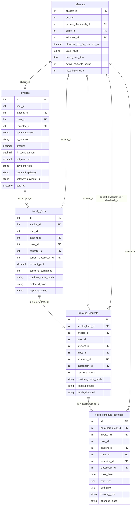
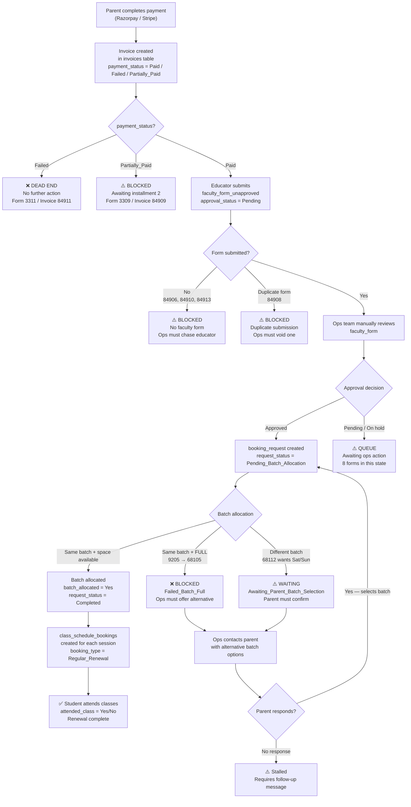
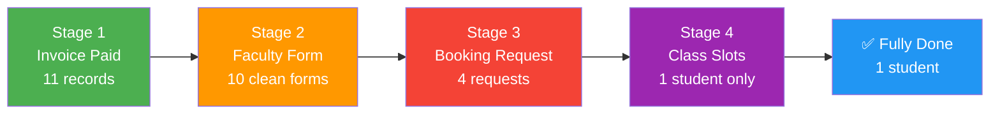

# DATA RELATIONSHIPS — Bambinos.live AI Program Manager

> **Date**: 2026-11-05 | **Source**: Programmatic analysis of 5 CSV files  
> **Ground rule**: All findings derived from actual data. No relationships assumed.

---

## Table of Contents

1. [The Five-Table Landscape](#1-the-five-table-landscape)
2. [ER Diagram (Mermaid)](#2-er-diagram)
3. [Relationship-by-Relationship Breakdown](#3-relationship-by-relationship-breakdown)  
   3.1 [invoices ↔ faculty_form](#31-invoices--faculty_form)  
   3.2 [faculty_form ↔ booking_requests](#32-faculty_form--booking_requests)  
   3.3 [booking_requests ↔ class_schedule_bookings](#33-booking_requests--class_schedule_bookings)  
   3.4 [reference → all tables (validation layer)](#34-reference--all-tables)
4. [Matching Key Reliability Analysis](#4-matching-key-reliability-analysis)
5. [Cardinality Summary](#5-cardinality-summary)
6. [Records That Cannot Be Matched](#6-records-that-cannot-be-matched)
7. [Duplicate Record Analysis](#7-duplicate-record-analysis)
8. [Renewal Process Workflow Diagram](#8-renewal-process-workflow-diagram)
9. [Key Findings and Implications](#9-key-findings-and-implications)

---

## 1. The Five-Table Landscape

The five tables represent four distinct **stages of the student renewal pipeline**, plus one **reference/validation layer**:

```
┌──────────────────────────────────────────────────────────────┐
│  STAGE 1          STAGE 2            STAGE 3        STAGE 4  │
│  invoices  ──►  faculty_form  ──►  booking_req  ──►  slots   │
│  (payment)      (educator form)    (batch alloc)   (classes) │
│                                                              │
│       └────────────── reference (validation) ────────────┘  │
└──────────────────────────────────────────────────────────────┘
```

| Table | Stage | Primary Key | Records |
|---|---|---|---|
| `invoices` | 1 — Payment | `id` | 13 |
| `faculty_form` | 2 — Educator form | `id` | 12 |
| `booking_requests` | 3 — Batch allocation | `id` | 4 |
| `class_schedule_bookings` | 4 — Class slots | `id` | 2 |
| `reference` | Validation layer | `student_id` | 13 |

> [!IMPORTANT]
> `invoice_id` is the **primary join spine** threading through Stages 1–4. However, it is **not sufficient alone** — when a form has the wrong `invoice_id` (e.g., form 3313 with ghost invoice 84931), other fields like `student_id` and `class_id` are needed to detect the anomaly.

---

## 2. ER Diagram



---

## 3. Relationship-by-Relationship Breakdown

### 3.1 `invoices` ↔ `faculty_form`

**Join key (primary)**: `invoices.id = faculty_form.invoice_id`  
**Designed cardinality**: 1:1 (one payment → one educator form)  
**Actual cardinality**: 1:N (invoice 84908 has 2 forms — a data quality violation)

#### Coverage

| invoices.id | faculty_form.id(s) | Matched? |
|---|---|---|
| 84901 | 3301 | ✅ |
| 84902 | 3302 | ✅ |
| 84903 | 3303 | ✅ |
| 84904 | 3304 | ✅ |
| 84905 | 3305 | ✅ |
| 84906 | — | ❌ No form |
| 84907 | 3307 | ✅ |
| 84908 | **3308 + 3309** | ⚠️ Duplicate forms |
| 84909 | 3310 | ✅ |
| 84910 | — | ❌ No form |
| 84911 | 3311 | ✅ |
| 84912 | 3312 | ✅ |
| 84913 | — | ❌ No form (3313 references ghost invoice 84931) |
| — | 3313 (84931) | ❌ Orphan form |

**Coverage stats**: 10 of 13 invoices cleanly matched · 3 invoices without a form · 1 orphan form

#### Multi-Key Consistency (programmatically verified)

When `invoice_id` matches, **all secondary keys are consistent** (`student_id`, `class_id`, `educator_id`) across all 11 matched pairs — with one notable exception:

| Invoice | `student_match` | `class_match` | `educator_match` | `amount_match` | Note |
|---|---|---|---|---|---|
| 84901–84905, 84907, 84911–84912 | ✅ | ✅ | ✅ | ✅ | Clean |
| 84908 | ✅ | ✅ | ✅ | ✅ | Two forms, same data |
| 84909 | ✅ | ✅ | ✅ | ❌ | Form records ₹10,500; invoice net = ₹5,250 (installment) |

> [!NOTE]
> `amount_paid` in `faculty_form` is **not a reliable join key** — for installment invoices, the educator records the full fee while the invoice records only the instalment received.

#### Why invoice_id alone is insufficient

If `invoice_id` contains a typo (like 84931 → 84913), the join silently fails and returns no match. The reconciliation engine must **also verify `student_id` + `class_id`** to detect and flag such orphan forms, and optionally suggest the correct invoice.

---

### 3.2 `faculty_form` ↔ `booking_requests`

**Join key (primary)**: `faculty_form.id = booking_requests.faculty_form_id`  
**Designed cardinality**: 1:1 (one approved form → one booking request)  
**Actual cardinality**: 1:0 or 1:1 (8 forms have no booking request at all)

#### Coverage

| faculty_form.id | booking_requests.id | approval_status | request_status |
|---|---|---|---|
| 3301 | 5501 | Approved | Completed |
| 3302 | 5502 | Approved | Pending_Batch_Allocation |
| 3303 | — | Pending | — |
| 3304 | — | Pending | — |
| 3305 | 5505 | Approved | Failed_Batch_Full |
| 3307 | — | Pending | — |
| 3308 | — | Pending | — |
| 3309 | — | Pending | — |
| 3310 | — | Pending | — |
| 3311 | — | Pending | — |
| 3312 | 5512 | Approved | Awaiting_Parent_Batch_Selection |
| 3313 | — | Pending | — |

**Key observation**: Every booking request that exists corresponds to an **Approved** faculty form. No `Pending` form has a booking request. This confirms the business rule: **approval is a prerequisite for booking request creation.**

#### Multi-Key Consistency

All 4 booking requests that exist pass a 4-key check (`faculty_form_id` + `invoice_id` + `student_id` + `class_id` + `educator_id`). Zero inconsistencies.

| booking_req.id | invoice_match | student_match | class_match | educator_match |
|---|---|---|---|---|
| 5501 | ✅ | ✅ | ✅ | ✅ |
| 5502 | ✅ | ✅ | ✅ | ✅ |
| 5505 | ✅ | ✅ | ✅ | ✅ |
| 5512 | ✅ | ✅ | ✅ | ✅ |

---

### 3.3 `booking_requests` ↔ `class_schedule_bookings`

**Join key (primary)**: `booking_requests.id = class_schedule_bookings.bookingrequest_id`  
**Designed cardinality**: 1:N (one booking request → many scheduled class dates)  
**Actual cardinality**: 1:0 or 1:N; only booking request 5501 has slots (2 dates)

#### Coverage

| booking_requests.id | Slots created | request_status | Reason for no slots |
|---|---|---|---|
| 5501 | **2 slots** | Completed | — (working) |
| 5502 | 0 | Pending_Batch_Allocation | Batch not yet assigned by ops |
| 5505 | 0 | Failed_Batch_Full | Batch 9205 at 6/6 capacity |
| 5512 | 0 | Awaiting_Parent_Batch_Selection | Parent hasn't chosen alternate batch |

#### Multi-Key Consistency (class_schedule_bookings → booking_requests)

All 5 foreign keys in both class slot rows match back to the booking request perfectly:

| Slot ID | invoice_match | student_match | class_match | educator_match | batch_match |
|---|---|---|---|---|---|
| 990101 | ✅ | ✅ | ✅ | ✅ | ✅ |
| 990102 | ✅ | ✅ | ✅ | ✅ | ✅ |

**Date format note**: `class_date` is stored as `YYYY-MM-DD` (date only), while all other timestamp fields across the five tables use `YYYY-MM-DD HH:MM:SS`. The reconciliation engine must handle this type mismatch explicitly.

---

### 3.4 `reference` → All Tables

The reference table is the **validation backbone** — it provides the canonical values that all operational tables should agree with.

#### Coverage: student_id join

| Table | Students in table | Matched to reference | Unmatched |
|---|---|---|---|
| invoices | 13 | **13/13** ✅ | 0 |
| faculty_form | 11 unique | **11/11** ✅ | 0 |
| booking_requests | 4 | **4/4** ✅ | 0 |
| class_schedule_bookings | 1 | **1/1** ✅ | 0 |

**All students in operational tables exist in the reference table.** The reference table is a complete master for all 13 active students.

#### Validation checks reference enables

| Check | Key used | Result |
|---|---|---|
| Is `class_id` correct for this student? | `student_id` → `reference.class_id` | ✅ All 13 invoices pass |
| Is `educator_id` correct? | `student_id` → `reference.educator_id` | ✅ All 13 pass |
| Does `invoice.amount` match standard fee? | `student_id` → `reference.standard_fee_24_sessions_inr` | ✅ All 13 gross amounts match |
| Is the target batch full? | `classbatch_id` → `reference.active_students_count / max_batch_size` | Batch 9205 is full (6/6) |
| Does mobile on invoice match registered mobile? | `student_id` → `reference.registered_mobile_masked` | 1 mismatch: invoice 84904 |

#### Batch Capacity (from reference)

| Batch | Active | Max | Available | Full? |
|---|---|---|---|---|
| 9201 | 4 | 6 | 2 | No |
| 9202 | 5 | 6 | 1 | No |
| 9203 | 3 | 6 | 3 | No |
| **9205** | **6** | **6** | **0** | **YES** |
| 9206 | 5 | 6 | 1 | No |
| 9207 | 4 | 6 | 2 | No |
| 9208 | 5 | 6 | 1 | No |
| 9209 | 4 | 6 | 2 | No |
| 9210 | 5 | 6 | 1 | No |
| 9211 | 5 | 6 | 1 | No |
| 9213 | 4 | 6 | 2 | No |

---

## 4. Matching Key Reliability Analysis

### Why `invoice_id` alone is not always sufficient

Tested all practical key combinations programmatically:

| Key Combination | Join: inv → ff | Matched | Orphan forms | Invoices without forms |
|---|---|---|---|---|
| `invoice_id` only | 11 | 11 | 1 (84931) | 3 (84906, 84910, 84913) |
| `invoice_id + student_id` | 11 | 11 | 1 | 3 |
| `invoice_id + student_id + class_id` | 11 | 11 | 1 | 3 |
| `invoice_id + student_id + educator_id` | 11 | 11 | 1 | 3 |

The match count does **not change** between single-key and composite-key joins — because when `invoice_id` matches, all other foreign keys are consistent. However, composite keys serve a different purpose: **detecting internal inconsistencies within matched rows** and enabling **fallback matching** when `invoice_id` is wrong.

### Recommended composite key strategy per join

| Join | Primary Key | Fallback / Validation Keys | Purpose of Fallback |
|---|---|---|---|
| invoices → faculty_form | `invoice_id` | `student_id + class_id + educator_id` | Detect orphan form 3313 (wrong invoice_id); suggest correct match |
| faculty_form → booking_requests | `faculty_form_id` | `invoice_id + student_id` | Confirm booking request belongs to the right form |
| booking_requests → class_schedule_bookings | `bookingrequest_id` | `invoice_id + student_id + classbatch_id` | Confirm all five FK fields agree end-to-end |
| any table → reference | `student_id` | `class_id + educator_id` | Validate class and educator assignment |
| reference → batch capacity | `classbatch_id` | `active_students_count + max_batch_size` | Determine if batch can accept the renewal |

### Key reliability score (assessed from data)

| Key | Reliable? | Notes |
|---|---|---|
| `invoice_id` | ✅ Reliable (primary) | One typo in dataset (84931); always verify with `student_id` |
| `student_id` | ✅ Reliable (universal) | Perfect 13/13 coverage across all tables |
| `faculty_form_id` | ✅ Reliable | No orphan references in booking_requests |
| `bookingrequest_id` | ✅ Reliable | No orphan references in class_schedule_bookings |
| `class_id` | ✅ Reliable | Consistent; 11 unique classes |
| `educator_id` | ✅ Reliable | Consistent; 6 educators |
| `classbatch_id` | ⚠️ Partially reliable | NULL for booking request 5512 (awaiting parent selection) |
| `amount_paid` | ❌ Not a join key | Differs from `net_amount` for installment invoices |
| `mobile` | ❌ Not a join key | One confirmed mismatch (invoice 84904 vs reference) |

---

## 5. Cardinality Summary

| Relationship | Type | Primary Key | Violations |
|---|---|---|---|
| `invoices` → `faculty_form` | **1:1 designed / 1:N actual** | `invoice_id` | Invoice 84908 has 2 forms |
| `faculty_form` → `booking_requests` | **1:0 or 1:1** | `faculty_form_id` | 8 of 12 forms have no booking request |
| `booking_requests` → `class_schedule_bookings` | **1:N** | `bookingrequest_id` | 3 of 4 requests have no slots |
| `reference` → `invoices` | **1:1** | `student_id` | No violations; perfect match |
| `reference` → `faculty_form` | **1:0 or 1:N** | `student_id` | Student 68108 has 2 forms |
| `reference` → `booking_requests` | **1:0 or 1:1** | `student_id` | 9 students have no booking request |
| `reference` → `class_schedule_bookings` | **1:0 or 1:N** | `student_id` | Only 1 student has slots |
| `reference` (batch) → `booking_requests` | **1:N** | `classbatch_id` | Batch 9205 at capacity |

---

## 6. Records That Cannot Be Matched

### Category A: Invoices with no faculty form

| Invoice | Student | Class | Payment Status | Reason |
|---|---|---|---|---|
| 84906 | 68106 | 108 | Paid | Educator has not submitted renewal form |
| 84910 | 68110 | 401 | Paid | Educator has not submitted renewal form |
| 84913 | 68113 | 501 | Paid | Educator submitted with wrong invoice_id (84931) |

### Category B: Faculty form with no matching invoice

| Form | Referenced Invoice | Student | Issue |
|---|---|---|---|
| 3313 | **84931** (ghost) | 68113 | Invoice 84931 does not exist. Actual invoice is 84913. Likely a numeric transposition. |

> [!NOTE]
> Form 3313 and Invoice 84913 share the same `student_id` (68113), `class_id` (501), `educator_id` (1130), and `amount_paid` (11,500). This is strong evidence of a typo. The reconciliation engine should flag this for human confirmation — **not auto-correct**.

### Category C: Faculty forms with no booking request

| Form | Invoice | Student | Approval | Reason Booking Request Not Created |
|---|---|---|---|---|
| 3303 | 84903 | 68103 | Pending | Form not yet approved |
| 3304 | 84904 | 68104 | Pending | Form not yet approved (mobile mismatch flag) |
| 3307 | 84907 | 68107 | Pending | Form not yet approved (discount flag) |
| 3308 | 84908 | 68108 | Pending | Duplicate submission; neither approved |
| 3309 | 84909 | 68109 | Pending | Form not yet approved (partial payment) |
| 3310 | 84910 | 68110 | Pending | Form not yet approved |
| 3311 | 84911 | 68111 | Pending | Payment FAILED — must never be approved |
| 3313 | 84931 | 68113 | Pending | Orphan form (wrong invoice reference) |

### Category D: Booking requests with no class slots

| Request | Form | Invoice | Student | Status | Root Cause |
|---|---|---|---|---|---|
| 5502 | 3302 | 84902 | 68102 | Pending_Batch_Allocation | Ops has not allocated a batch yet |
| 5505 | 3305 | 84905 | 68105 | Failed_Batch_Full | Batch 9205 is at capacity (6/6) |
| 5512 | 3312 | 84912 | 68112 | Awaiting_Parent_Batch_Selection | Parent hasn't chosen alternate batch |

---

## 7. Duplicate Record Analysis

### 7.1 Duplicate Faculty Forms (by invoice_id)

**Invoice 84908 has two distinct faculty form submissions:**

| Form ID | Invoice | Student | Educator | `created_at` | Difference |
|---|---|---|---|---|---|
| **3308** | 84908 | 68108 | 1115 | 2026-11-03 08:30:00 | Submitted first |
| **3309** | 84908 | 68108 | 1115 | 2026-11-03 08:35:12 | Submitted 5 min 12 sec later |

Both rows are identical across all data fields (same student, same class, same amount, same preferred days). The 5-minute gap suggests a double-click or accidental re-submission by the educator. **Neither has been approved; no booking request exists for either.**

> [!CAUTION]
> The reconciliation engine must not auto-approve either form when duplicates exist. Flag both as `DUPLICATE_FORM` and require a human to void one before proceeding.

### 7.2 Duplicate Class Schedule Bookings

**No duplicate class slots found.** Both entries in `class_schedule_bookings` are for different dates (2026-11-03 and 2026-11-05) for the same student — this is correct and expected (two upcoming sessions in a session block).

### 7.3 Potential Duplicate Booking Requests

**No duplicate booking requests found.** Each of the 4 booking requests references a distinct `faculty_form_id` and distinct `invoice_id`.

---

## 8. Renewal Process Workflow Diagram

### 8.1 Current (As-Is) Renewal Process



### 8.2 Process Stage Completion (Current State)



| Stage | Total Eligible | Completed | Blocked | % Done |
|---|---|---|---|---|
| Stage 1 — Invoice Paid | 13 | 11 Paid | 2 not Paid | 85% |
| Stage 2 — Faculty Form submitted | 11 paid | 10 have forms* | 1 no form (84906) | 91% |
| Stage 3 — Booking Request created | 4 Approved forms | 4 have requests | 8 forms not approved | 33% |
| Stage 4 — Class Slots created | 4 requests | 1 complete | 3 stalled | 25% |
| **End-to-end complete** | **13** | **1** | **12** | **8%** |

*Invoice 84913 has form 3313 but with wrong invoice ref; treated as blocked.

---

## 9. Key Findings and Implications

### Finding 1: `invoice_id` is necessary but not sufficient as a join key

Adding `student_id` + `class_id` as validation fields allows the engine to:
- Detect form 3313 (wrong `invoice_id` = 84931; correct student 68113 and class 501 still found in reference)
- Cross-validate that form data wasn't submitted for the wrong student

**Recommendation**: Always join on `invoice_id` as primary; validate `student_id`, `class_id`, `educator_id` as consistency checks.

### Finding 2: `faculty_form.amount_paid` ≠ `invoices.net_amount` for installments

For `payment_type = Installment_1_of_2` (invoice 84909), the educator recorded the full fee (₹10,500) while only ₹5,250 was actually received. `amount_paid` cannot be used as a join or validation key — only `invoices.net_amount` and `invoices.payment_status` are authoritative.

**Recommendation**: The reconciliation engine must read payment status **exclusively from `invoices`**.

### Finding 3: Approval is a hard gate for booking request creation

**100% of booking requests** correspond to Approved faculty forms. No Pending form has ever generated a booking request. This is a confirmed business rule — not an assumption.

**Recommendation**: The auto-approval engine is the critical bottleneck. Any form that passes all checks should be auto-approved to unblock booking request creation.

### Finding 4: `reference` validates six fields but `mobile` is unreliable across tables

The reference table provides authoritative values for `class_id`, `educator_id`, `standard_fee_24_sessions_inr`, `batch_days`, and `registered_mobile_masked`. However, `invoices.mobile` can legitimately differ (e.g., parent pays from spouse's phone). `mobile` should be a **soft flag**, not a hard block.

### Finding 5: Batch 9205 is the only full batch — and already blocked

Of 11 unique batches in the reference table, only batch 9205 (Unbox Chess L2) is at capacity. Student 68105's renewal is already in `Failed_Batch_Full` state. The engine needs an alternative batch suggestion workflow for this case.

### Finding 6: The pipeline loses 92% of records before completion

Only 1 of 13 invoices reaches Stage 4. The primary bottleneck is at **Stage 2→3** (approval gate): 8 of 12 faculty forms are still Pending. Auto-approving eligible forms is the highest-leverage action this system can take.

---

*Document complete — 2026-11-05. Ready for Task 3: Reconciliation Engine.*

