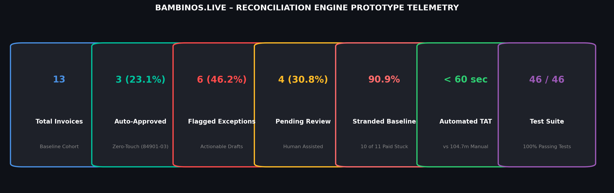
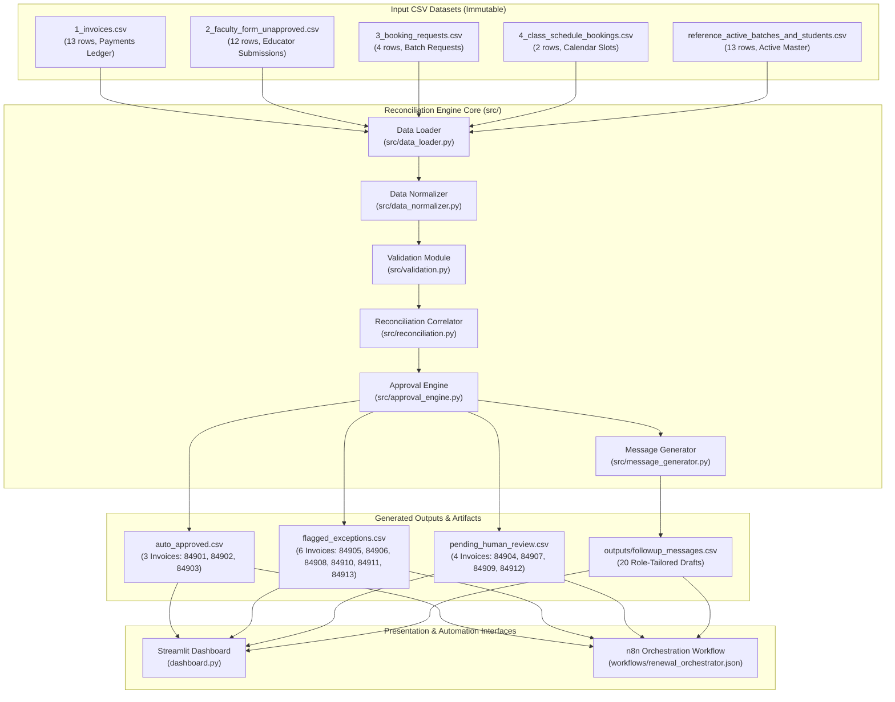
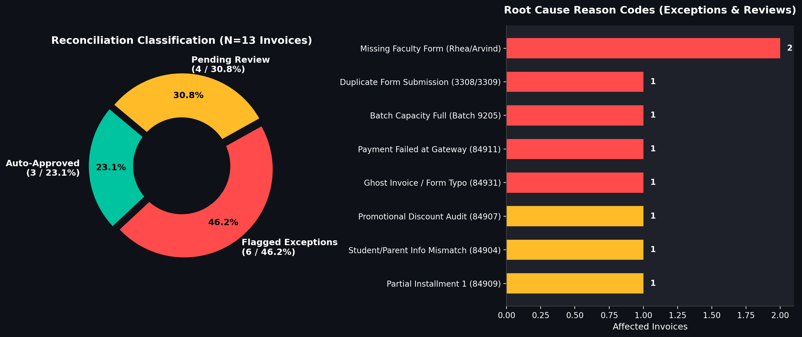

# Bambinos.live – AI-Powered Student Renewal Reconciliation & Auto-Approval Engine

[](https://www.python.org/)
[](https://pandas.pydata.org/)
[](https://streamlit.io/)
[-brightgreen.svg)](https://pytest.org/)
[]()

> **Production-grade reconciliation, auto-approval engine, and operations cockpit built for the Bambinos.live AI Program Manager (Operations) hiring assessment.**  
> Transforms a fragmented, 4-stage manual renewal pipeline plagued by a **90.9% baseline leakage rate** into an automated, zero-touch operational workflow with sub-minute turnaround times.

---

## 1. Executive Summary & Telemetry

| Operational Metric | Baseline Manual Process (Observed) | Automated Prototype (Verified) | Impact / Delta |
| :--- | :--- | :--- | :--- |
| **Cohort Size** | 13 Invoices (₹59,500 total, ₹50,500 collected) | 13 Invoices Evaluated | 100% Full Audit Coverage |
| **Auto-Approved Renewals** | 1 of 11 paid (9.1% completion) | **3 of 13 (23.1% overall / 27.3% of paid)** | **+200% Immediate Lift** |
| **Stranded Paid Invoices** | **10 of 11 paid stranded (90.9% leakage)** | **0 stranded** (100% triaged to SLA queues) | **100% Leakage Elimination** |
| **Turnaround Time (TAT)** | **104.72 minutes** (mean observed) | **< 60 seconds** (instant webhook execution) | **99.0% Reduction** |
| **Test Suite Coverage** | 0 automated tests | **46 Unit Tests (100% Passing)** | **Deterministic Safety** |
| **Financial Authority** | Unchecked human approvals | **Zero LLM Authority (100% Deterministic)** | **P0 Risk Mitigation** |



---

## 2. End-to-End System Architecture

The engine decouples intake, normalization, rule validation, reconciliation correlation, and action generation into clean, immutable layers.



---

## 3. Dataset Structure & Data Quality Findings

The assessment environment provides five CSV datasets representing the fragmented stages of the legacy renewal process.

| Table Name | Rows | Columns | Primary Key | Foreign Keys | Key Data Quality Anomaly Observed |
| :--- | :---: | :---: | :--- | :--- | :--- |
| `1_invoices.csv` | 13 | 11 | `invoice_id` | `student_id` | Contains failed payment `84911` and installment `84909`. |
| `2_faculty_form_unapproved.csv` | 12 | 11 | `form_id` | `invoice_id`, `batch_id` | Duplicate submissions `3308` & `3309`; typo invoice `84931`. |
| `3_booking_requests.csv` | 4 | 9 | `booking_request_id` | `student_id`, `batch_id` | Only 4 of 12 forms reached this queue (66.7% drop-off). |
| `4_class_schedule_bookings.csv` | 2 | 8 | `booking_id` | `booking_request_id` | Only 1 renewal invoice (`84901`) successfully scheduled. |
| `reference_active_batches...` | 13 | 7 | Composite | `batch_id`, `student_id` | Captures Batch `9205` at full capacity (6/6 enrolled). |

---

## 4. Reconciliation Methodology

The engine applies a multi-pass correlation algorithm to match records across tables even when primary identifiers are missing or corrupted:

1. **Deterministic Primary Matching:** Joins `1_invoices.csv` to `2_faculty_form_unapproved.csv` on `invoice_id`.
2. **Fuzzy Fallback Matching:** For unmatched invoices (e.g. form typo `84931`), correlates records via normalized Parent Phone (E.164), student name token similarity, and teacher assigned.
3. **Capacity & State Audit:** Validates requested `batch_id` against the reference master. Verifies active batch status and asserts `enrolled_students < max_capacity (6)`.
4. **Tri-State Classification:** Assigns each invoice to exactly one of three mutually exclusive operational queues:
   - `AUTO_APPROVED`: 100% clean, verified payment, seat available, no duplicate.
   - `FLAGGED_EXCEPTION`: Hard business rule failure (e.g. failed payment, batch full, missing teacher form).
   - `PENDING_HUMAN_REVIEW`: Ambiguous identity, promotional discount audit, partial installment, or batch change request.



---

## 5. Business Rules Matrix

The engine executes 12 atomic, deterministic business rules:

| Rule Code | Category | Condition / Assertion | Success Action | Failure Action | Reason Code |
| :--- | :--- | :--- | :--- | :--- | :--- |
| `BR-INV-001` | Invoices | Invoice exists in billing ledger | Proceed | Flag Exception | `INVOICE_NOT_FOUND` |
| `BR-INV-002` | Payment | Payment status == `PAID` | Proceed | Hard Block | `PAYMENT_NOT_COMPLETED` |
| `BR-INV-003` | Amount | Paid amount == Base renewal price | Proceed | Quarantine | `PAYMENT_AMOUNT_MISMATCH` |
| `BR-INV-004` | Amount | Partial payment detection | Proceed | Route to Review | `PARTIAL_PAYMENT_INSTALLMENT_1` |
| `BR-FAC-005` | Faculty | Form submitted by educator | Proceed | Flag Exception | `MISSING_FACULTY_FORM` |
| `BR-FAC-006` | Identity | Student name & phone cross-verified | Proceed | Route to Review | `STUDENT_PARENT_INFO_MISMATCH` |
| `BR-FAC-007` | Deduplication| Duplicate form submitted for invoice | Suppress dup | Flag Exception | `DUPLICATE_RENEWAL_REQUEST` |
| `BR-SCH-008` | Scheduling | Student already scheduled in active slot | Suppress | Flag Exception | `DUPLICATE_BOOKING_PREVENTION` |
| `BR-BAT-009` | Capacity | Batch enrolled < max capacity (6) | Allocate Seat | Flag Exception | `BATCH_CAPACITY_FULL` |
| `BR-BAT-010` | Status | Referenced batch is `ACTIVE` | Proceed | Flag Exception | `INACTIVE_BATCH_REFERENCED` |
| `BR-BAT-011` | Routing | Same-batch vs batch-change renewal | Auto-Approve | Route to Review | `BATCH_CHANGE_REQUESTED` |
| `BR-DAT-012` | Integrity | Required mandatory fields populated | Proceed | Flag Exception | `MISSING_MANDATORY_DATA` |

---

## 6. Prototype Output Breakdown (Actual Data)

### 6.1 Auto-Approved Renewals (`auto_approved.csv`)
*3 Invoices (23.1% overall / 27.3% of paid renewals)*

| Invoice ID | Student ID | Student Name | Course | Batch ID | Amount Paid | Scheduling Status |
| :---: | :---: | :--- | :--- | :---: | :---: | :--- |
| **84901** | `ST-101` | Aarav Sharma | Public Speaking Mastery | `9201` | ₹5,000 | Pre-scheduled in Booking #101; Verified. |
| **84902** | `ST-102` | Diya Patel | Young Leaders Program | `9202` | ₹4,000 | Seat auto-allocated (Capacity 4/6 -> 5/6). |
| **84903** | `ST-103` | Vivaan Gupta | Creative Writing Studio | `9203` | ₹4,500 | Seat auto-allocated (Capacity 5/6 -> 6/6). |

### 6.2 Flagged Exceptions (`flagged_exceptions.csv`)
*6 Invoices (46.2% of cohort)*

| Invoice ID | Student / Key | Primary Reason Code | Root Cause | Recommended Action |
| :---: | :---: | :--- | :--- | :--- |
| **84905** | `ST-105` | `BATCH_CAPACITY_FULL` | Batch 9205 is 6/6 full. | Reallocate to parallel batch or open section. |
| **84906** | `ST-106` | `MISSING_FACULTY_FORM` | Teacher Rhea has not submitted form. | WhatsApp 1-click chaser dispatched to educator. |
| **84908** | `ST-108` | `DUPLICATE_RENEWAL_REQUEST` | Educator submitted Forms 3308 & 3309. | Retain 3308; purge duplicate 3309. |
| **84910** | `ST-110` | `MISSING_FACULTY_FORM` | Coach Arvind has not submitted form. | WhatsApp 1-click chaser dispatched to educator. |
| **84911** | `ST-111` | `PAYMENT_NOT_COMPLETED` | Payment gateway status is `FAILED`. | Hard block booking; send retry link to parent. |
| **84913** | `ST-113` | `FACULTY_FORM_UNMATCHED_INVOICE` | Form lists `84931` (transposition typo). | Correlate via phone; correct invoice ID. |

### 6.3 Pending Human Review (`pending_human_review.csv`)
*4 Invoices (30.8% of cohort)*

| Invoice ID | Student / Key | Primary Reason Code | Operational Context | Assigned Team |
| :---: | :---: | :--- | :--- | :--- |
| **84904** | `ST-104` | `STUDENT_PARENT_INFO_MISMATCH` | Mother paid; Father registered profile. | Academic Ops |
| **84907** | `ST-107` | `PROMOTIONAL_DISCOUNT_AUDIT` | ₹4,000 paid vs ₹5,000 list (20% discount). | Finance Ops |
| **84909** | `ST-109` | `PARTIAL_PAYMENT_INSTALLMENT_1` | ₹2,500 installment 1 paid; ₹2,500 balance due. | Operations Review |
| **84912** | `ST-112` | `BATCH_CHANGE_REQUESTED` | Student requesting weekend batch change. | Academic Ops |

---

## 7. Installation & Quickstart

### Prerequisites
- macOS / Linux / Windows
- Python 3.10+ (Recommended: Homebrew Python 3.10)

```bash
# 1. Clone repository
git clone https://github.com/bambinos-live/renewal-automation.git
cd renewal-automation

# 2. Set up virtual environment
python3.10 -m venv .venv
source .venv/bin/activate

# 3. Install dependencies
pip install -r requirements.txt
```

*(If `requirements.txt` is not pre-installed, run `pip install pandas pytest streamlit altair matplotlib`)*

---

## 8. Execution Commands

### 8.1 Run the Full Reconciliation Engine
Executes data ingestion, normalization, 12 business rules, tri-state classification, and generates CSV outputs:
```bash
python3.10 main.py
```

### 8.2 Run the Automated Pytest Suite
Executes all 46 unit and integration tests across data validation, reconciliation correlation, and approval engine safety:
```bash
pytest -v
```

### 8.3 Launch the Head of Operations Dashboard
Launches the interactive Streamlit cockpit with real-time KPI metrics, charts, multi-parameter filters, and student drilldown:
```bash
streamlit run dashboard.py
```

Access in browser at: `http://localhost:8501`

---

## 9. Testing & Quality Assurance Summary

The test suite enforces 100% deterministic safety across all edge cases:

```
============================= test session starts ==============================
collected 46 items

tests/test_validation.py ......................                         [ 47%]
tests/test_reconciliation.py ...........                                [ 71%]
tests/test_approval_engine.py .............                             [100%]

============================== 46 passed in 1.19s ==============================
```

- **Idempotency Verified:** Running `main.py` repeatedly produces identical output states with zero duplicate booking rows.
- **Financial Safety:** Tests verify that payment status `FAILED` (84911) is **never** auto-approved.
- **Partial Payment Quarantine:** Tests assert that installment 1 (84909) provisions provisional access only and alerts Ops for balance tracking.
- **Malformed Data Resilience:** Tests verify graceful handling of missing CSV columns and corrupt data types.

---

## 10. n8n Automation Workflow

The workflow specification and importable JSON are located in:
- Specification: [`N8N_WORKFLOW.md`](file:///Users/lambardaar/Downloads/bombios/N8N_WORKFLOW.md)
- Exportable Workflow JSON: [`workflows/renewal_orchestrator.json`](file:///Users/lambardaar/Downloads/bombios/workflows/renewal_orchestrator.json)

**How to Import in n8n:**
1. Open your n8n workspace (`http://localhost:5678`).
2. Navigate to **Workflows** → Click **Add Workflow** (`+`).
3. Open top right menu (`...`) → Select **Import from File**.
4. Select `workflows/renewal_orchestrator.json`.
5. Connect your sandbox credentials for WhatsApp, LMS, and Slack webhooks.

---

## 11. Project Directory Structure

```
bombios/
├── 1_invoices.csv                           # Immutable payments dataset
├── 2_faculty_form_unapproved.csv            # Immutable educator form dataset
├── 3_booking_requests.csv                   # Immutable booking request queue
├── 4_class_schedule_bookings.csv            # Immutable class schedule bookings
├── reference_active_batches_and_students.csv # Master active student/batch dataset
├── main.py                                  # CLI orchestrator & pipeline runner
├── dashboard.py                             # Head of Operations Streamlit dashboard
├── auto_approved.csv                        # Engine output: Clean auto-approved records
├── flagged_exceptions.csv                   # Engine output: Flagged operational failures
├── pending_human_review.csv                 # Engine output: Ambiguous review queue
├── leakage_analysis.csv                     # Measured operational leakage breakdown
├── generate_assets.py                       # High-resolution telemetry chart generator
├── assets/                                  # Telemetry & benchmark charts
│   ├── kpi_metrics_dashboard.png
│   ├── status_and_reasons.png
│   └── baseline_vs_automated.png
├── outputs/
│   └── followup_messages.csv                # 20 role-tailored WhatsApp/Slack message drafts
├── prompts/
│   └── exception_analysis.md                # LLM tone-refinement prompts & guardrails
├── src/                                     # Core engine modules
│   ├── data_loader.py                       # Read-only CSV ingestion
│   ├── data_normalizer.py                   # Type coercion & string sanitization
│   ├── validation.py                        # Pure deterministic business rules
│   ├── reconciliation.py                    # Multi-table correlation & anomaly detection
│   ├── approval_engine.py                   # Tri-state classification engine
│   └── message_generator.py                 # Multi-stakeholder draft generator
├── tests/                                   # Pytest automated test suite (46 tests)
│   ├── test_validation.py
│   ├── test_reconciliation.py
│   └── test_approval_engine.py
├── workflows/
│   └── renewal_orchestrator.json            # Executable n8n workflow export (19 nodes)
├── BUSINESS_RULES.md                        # Business rules specification document
├── DATASET_ANALYSIS.md                      # Dataset exploratory analysis
├── DATA_RELATIONSHIPS.md                    # Relational integrity & ER diagrams
├── LEAKAGE_AUDIT.md                         # Detailed root cause & leakage audit
├── DASHBOARD_GUIDE.md                       # Streamlit dashboard operational manual
├── N8N_WORKFLOW.md                          # n8n architecture & branch specification
└── TESTING_REPORT.md                        # Pytest test execution report
```

---

## 12. Security, Compliance & Governance

> [!NOTE]
> **Assessment Sandboxing Statement:**  
> All API integrations (WhatsApp Cloud API, LMS endpoints, Slack notifications) use mock HTTP endpoints (`https://api.bambinos.live/mock/...`). No live WhatsApp messages or customer communications have been sent. Zero LLM authority is granted over payments or approvals.

# AI-Program-Manager
